# jxb: System Architecture and Internals

**A reproducible cross-development, deployment and observability environment for ROS 2 on NVIDIA Jetson Orin**

Technical documentation, version of 2026-11-04 (repository state after commit `bb3088a`). A typeset version with
the same content is in [latex/jxb.pdf](latex/jxb.pdf) (source: [latex/jxb.tex](latex/jxb.tex)). For day-to-day
use, start with [getting-started.md](getting-started.md); the command reference is [workflows.md](workflows.md);
the raw engineering log is [findings.md](findings.md) (entries F1 to F62, cited below as *F n*).

---

## Abstract

Developing ROS 2 software with CUDA, TensorRT and ONNX Runtime for embedded NVIDIA Jetson Orin modules is commonly
done either directly on the board, which is slow and memory-bound, or in an emulated arm64 environment on a PC,
which is slower still and breaks for CUDA. Cross-compilation avoids both, but it is only correct if the build sees
exactly the libraries that the board will load at run time. This document describes **jxb**, an environment that
(i) constructs the target root file system (*sysroot*) deterministically from the board's own package
repositories, without emulation and without access to a board; (ii) compiles C++, CUDA and Python extension code
with an x86_64 cross toolchain whose every component is pinned to the board's software release; (iii) deploys,
runs, launches and debugs the result on unmodified, shared boards, either natively or in a GPU-enabled container
derived from the same sysroot; and (iv) records and analyzes system behaviour with Nsight Systems, tegrastats,
per-process sampling, kernel tracing and inference benchmarks, emitting machine-readable summaries. The design is
inspired by the Renesas RZ/V2H RDK cross-build environment, whose structure it adopts and whose central limitation,
a sysroot mirrored from a board, it removes. We describe the architecture and each mechanism in depth, report
measurements on an Orin Nano 8 GB with JetPack 7.2.1 (for example, a 3.2x lower latency of the SAM detector model
with a TensorRT fp16 engine than with ONNX Runtime's CUDA execution provider, and the full SAM autonomy stack running
at 2.8 CPU cores, 2.1 GB and 8.4 W), and discuss the problems encountered during the implementation (62 recorded
findings) and how they were resolved.

---

## Contents

1. [Introduction](#1-introduction)
2. [Background and concepts](#2-background-and-concepts)
3. [System architecture](#3-system-architecture)
4. [Deep dive I: the sysroot builder](#4-deep-dive-i-the-sysroot-builder)
5. [Deep dive II: the cross toolchain](#5-deep-dive-ii-the-cross-toolchain)
6. [Deep dive III: deployment and the board runtime](#6-deep-dive-iii-deployment-and-the-board-runtime)
7. [Deep dive IV: observability](#7-deep-dive-iv-observability)
8. [VS Code integration](#8-vs-code-integration)
9. [Evaluation](#9-evaluation)
10. [Challenges and lessons learned](#10-challenges-and-lessons-learned)
11. [Implementation process](#11-implementation-process)
12. [Limitations and future work](#12-limitations-and-future-work)
13. [Conclusion](#13-conclusion)
- [Appendix A: command reference](#appendix-a-command-reference)
- [Appendix B: configuration reference](#appendix-b-configuration-reference)
- [Appendix C: the `summary.json` schema](#appendix-c-the-summaryjson-schema)
- [Appendix D: FAQ and known issues](#appendix-d-faq-and-known-issues)
- [Appendix E: glossary](#appendix-e-glossary)
- [References](#references)

---

## 1. Introduction

### 1.1 Motivation

The system was built for the SAM project, an autonomous model vehicle whose ROS 2 stack (about 27 packages:
camera drivers, image processing with CV-CUDA, a YOLO object detector on ONNX Runtime, localization, an acados-based
trajectory planner, control) runs on NVIDIA Jetson Orin modules. Before jxb, the team used a setup derived from the
Renesas RZ/V2H RDK, which had five recurring problems:

| # | Problem | Effect |
|---|---|---|
| P1 | The sysroot was `rsync`ed from a live board | not reproducible; drifts with every board; needs a prepared board before anything can be built |
| P2 | CUDA code was built in an emulated (QEMU) arm64 chroot | slow; `nvcc` and linking often failed, so CUDA packages were built on the board |
| P3 | Distribution mismatch | the stack targets ROS 2 Lyrical (Ubuntu 26.04), the board runs JetPack 7.2.1 (Ubuntu 24.04) |
| P4 | No multi-board view | no common deploy, trace collection or health view |
| P5 | CUDA minor-version drift | the desktop dev image has CUDA 13.3, the board 13.2; TensorRT engines are version-bound |

### 1.2 Requirements

From these problems and from the operating conditions (one shared lab board, several developers, later a fleet),
the following requirements were derived:

- **R1 Reproducibility.** The build environment is a function of a declarative profile, not of a board's history.
- **R2 Exact ABI match.** Every header and library used at build time is the version the board loads.
- **R3 No emulation for compilation.** C++, CUDA and Python extensions are compiled by native x86_64 compilers.
- **R4 Boards stay stock.** No `apt` changes, no writes outside `~/jxb/`, no root; boards are shared.
- **R5 Several ROS 2 distributions** (Jazzy, Kilted, Lyrical) on the same stock board, switchable per command.
- **R6 One workflow, three front ends.** The same operations from the terminal, from VS Code and, later, from a GUI.
- **R7 Observability with machine-readable results** (CPU, memory, GPU, power, kernel scheduling, inference).
- **R8 Safety on shared hardware.** Measurements must not overlap; leftovers must not keep running.

### 1.3 Contributions

1. A **sysroot builder** that resolves the arm64 package closure with a private `apt` instance against the board's
   repositories and reproduces the relevant side effects of maintainer scripts without executing them
   (Section 4).
2. A **CMake/colcon cross toolchain** for C, C++, CUDA and Python extensions, including the corrections that
   CUDA 13.2, CMake and ROS 2 need for host builds (Section 5).
3. A **board runtime model** that makes stock boards run other ROS distributions, either by shipping a relocatable
   ROS tree plus missing libraries (found by an `ldd` fix-point iteration) or by running a container image created
   from the sysroot itself (Section 6).
4. A **Renesas-style remote launch mode** with process-group-based lifecycle management, monitoring and bag
   recording, and SSH-tunnelled remote debugging (Section 6).
5. An **observability pipeline** that turns Nsight Systems databases, tegrastats logs, `/proc` samples and ftrace
   text into one `summary.json` per recording (Section 7).
6. An **evaluation** on the SAM stack, and a catalogue of 62 findings, several of them upstream bugs (Sections 9
   and 10).

### 1.4 Conventions

*Host* is the x86_64 PC, *board* the Jetson. Paths such as `~/jxb/<profile>` are board paths; `sysroots/<profile>`
is relative to the repository on the host. `{profile}` stands for a profile name such as `jp721-kilted`.
Code excerpts are taken from the repository and abridged where marked with `…`.

---

## 2. Background and concepts

This section introduces the concepts the rest of the document relies on. Readers familiar with cross-compilation,
JetPack and colcon may skip to Section 3.

### 2.1 Cross-compilation in a nutshell

In GNU terminology, the *build* machine runs the compiler, the *host* machine runs the produced program (here: the
board; in this document we nevertheless call the PC "host", as is common in embedded practice). Producing correct
binaries for another machine requires two things:

1. A **toolchain** that emits code for the target instruction set and ABI: here `aarch64-linux-gnu-gcc` (GCC 13
   on Ubuntu 24.04, the board userspace's compiler) and NVIDIA's `nvcc`.
2. A **sysroot**: a directory that looks like the target's root file system for the purposes of compiling and
   linking. The compiler finds headers in `<sysroot>/usr/include`, the linker finds libraries in
   `<sysroot>/usr/lib/aarch64-linux-gnu`, and both treat `<sysroot>` as `/`.

Linking against a shared library records information that the board's dynamic loader (`ld-linux-aarch64.so.1`)
later relies on. Understanding these records explains most cross-build failures discussed in Section 10:

| ELF record | Meaning | Typical cross-build failure |
|---|---|---|
| `DT_NEEDED` | library names to load (normally the `SONAME`, e.g. `libcudart.so.13`) | an absolute host path is recorded when a library has no `SONAME` (F44) |
| `DT_RUNPATH` / `DT_RPATH` | search directories baked into the binary | host paths such as `/home/...` leak in |
| version needs (`.gnu.version_r`) | required symbol versions, e.g. `GLIBC_2.38`, `GLIBCXX_3.4.32` | binary built against a newer glibc/libstdc++ than the board has |
| `PT_INTERP` | path of the dynamic loader | wrong loader for the target |
| ISA flags | instruction-set extensions used by the code | code faults (`SIGILL`) on a CPU without them (F25) |

A sysroot is *correct* when, for every file the build reads, the sysroot's version equals the version installed on
the board. jxb's central claim is that this can be guaranteed by construction instead of by copying (Section 4).

### 2.2 The Jetson Orin platform and JetPack 7.2.1

The Orin modules combine Arm Cortex-A78AE cores with an NVIDIA Ampere GPU (compute capability 8.7, `sm_87`) that
shares the LPDDR5 memory with the CPU. The board used for all measurements is an **Orin Nano 8 GB** (6 cores,
7.3 GB usable RAM, 25 W power mode, NVMe storage) running a **PREEMPT_RT** kernel (`6.8.12-rt-tegra`).

JetPack 7.2.1 is NVIDIA's software release for it: Jetson Linux (L4T) 39.2.1 on Ubuntu 24.04, CUDA 13.2
(`cudart` 13.2.86), cuDNN 9.20, TensorRT 10.16.2, VPI 4.1 and an NVIDIA build of OpenCV 4.8 (F1). All of it is
installed with `apt` from three NVIDIA repositories (`repo.download.nvidia.com/jetson/{common,som,ffmpeg} r39.2`),
which an apt preference pins above Ubuntu's packages (priority 600). Two platform details matter later:

- **CUDA 13 uses the unified Arm ("SBSA") layout** `targets/sbsa-linux` on Orin, not `aarch64-linux` as in
  JetPack 6 (F2).
- **The CUDA driver is installed per GPU variant** under `/opt/nvidia/l4t-gpu-libs/{nvgpu,openrm}`; a boot service
  publishes the active one (F26). An extracted sysroot therefore has no `libcuda.so.1` until that step is replayed.

### 2.3 ROS 2 builds: colcon, ament and code generators

A ROS 2 workspace is built by **colcon**, which builds each package (CMake or Python) in dependency order and
installs it into an *install space*. Packages find each other through `CMAKE_PREFIX_PATH`/`AMENT_PREFIX_PATH` and
the ament resource index; at run time, generated `setup.bash`/`local_setup.bash` scripts put the install space on
`PATH`, `LD_LIBRARY_PATH` and `PYTHONPATH`. The ROS installation itself (`/opt/ros/<distro>`) is the *underlay*.

Cross-building ROS 2 is harder than cross-building a plain CMake project because **code generators run during the
build**: `rosidl` turns `.msg` files into C, C++ and Python sources, ament writes CMake config files. These tools
are Python programs that must run on the build machine, while the code they emit is compiled for the target.
jxb therefore installs ROS 2 twice: on the host for the generators, in the sysroot for the target libraries, both
from the same distribution sync.

### 2.4 The CUDA compilation model

`nvcc` splits a `.cu` file into device code, compiled to GPU machine code (SASS) for a given architecture such as
`sm_87` and optionally to PTX for just-in-time compilation, and host code, which it passes to a host C++ compiler
(`-ccbin`). Because nvcc itself is an x86_64 program that only needs target headers and libraries for the host part,
it can cross-compile: with `-ccbin aarch64-linux-gnu-g++` and `--target-directory sbsa-linux`, the device code is
the same as on the board and the host code is aarch64. This is what removes problem P2.

### 2.5 The reference: Renesas RZ/V2H RDK cross-build environment

Renesas documents a cross-build setup for its RZ/V2H RDK that is the model for jxb's structure
([R1](#references)-[R4](#references)). Its development guide introduces the concepts and limitations of
cross-compiling, then walks through environment setup (a Docker image `rzv2h_ubuntu_xbuild` with an arm64 sysroot
baked into `/opt/arm64_sysroot`), a usage guide (workspace layout, an arm64 chroot via QEMU for `rosdep`,
`cross-colcon-build`), a VS Code workspace with tasks for build, deployment and remote debugging via `gdbserver`,
a tutorial, known issues (for example, non-relocatable CMake paths inside the sysroot) and an FAQ. Numbered
procedures, notes and tips make it easy to follow. This document borrows that structure: concepts first, then
architecture, then each workflow, with known issues and an FAQ at the end.

jxb keeps the RDK's good ideas (one command per workflow, a long-lived build container, VS Code tasks that wrap
CLI commands, gdbserver debugging) and changes what did not scale for a Jetson fleet. The SAM team's earlier
Jetson setup, derived from the RDK, synchronized its sysroot from live boards and built CUDA code in the emulated
chroot (problems P1 and P2); the comparison below refers to the RDK image and that derived workflow:

| Aspect | RDK-based setup | jxb |
|---|---|---|
| Sysroot origin | prebuilt and baked into the image (`/opt/arm64_sysroot`, 14.5 GB image); for Jetson synced from boards | built from the board's apt repositories, separately per profile |
| Emulation | arm64 chroot (QEMU) for `rosdep`; in the Jetson workflow also for CUDA builds | none for compilation; QEMU only for optional smoke tests |
| CUDA | not part of the RDK (other SoC) | x86 `nvcc` of the board's exact version, `sm_87` |
| Distros | one (Jazzy) | profiles: Jazzy, Kilted, Lyrical on 24.04, Lyrical on 26.04 |
| Boards | one configured target, password-based SSH (`sshpass`) | inventory of boards, SSH keys only, nothing installed on the board |
| Run-time modes | native | native or container, per command |
| Observability | not part of the cross-build guide | Nsight Systems, tegrastats, `/proc` sampling, ftrace, benchmarks, `summary.json` |

---

## 3. System architecture

### 3.1 Overview

jxb consists of a host-side CLI and the artefacts it manages on the host and on boards (Figure 1).

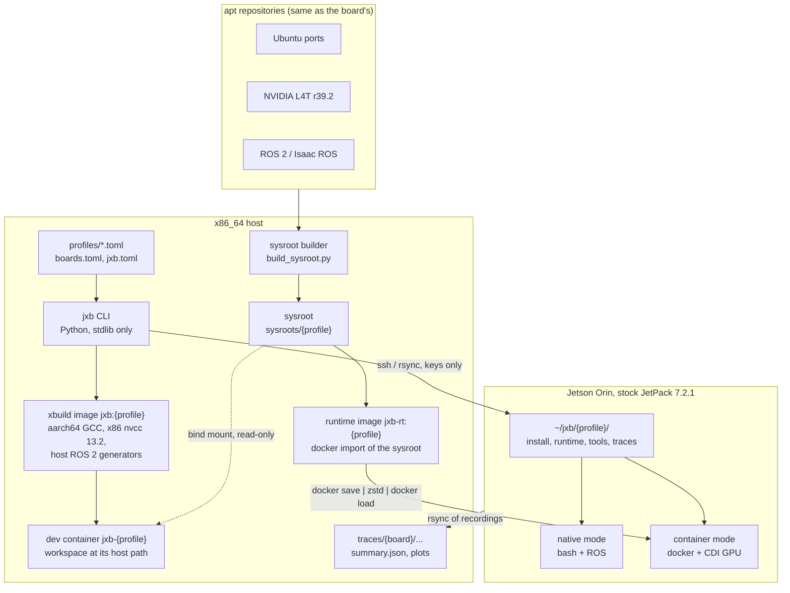

*Figure 1: Components and data flows. Solid arrows are data produced or transferred; the dotted arrow is a mount.*

The host holds four kinds of artefacts per profile: the **xbuild image** (host tools only, ~3.4 GB), the
**sysroot** (target files only, 16-19 GB), the **dev container** that combines both with the developer's workspace,
and, for container mode, the **runtime image** (the sysroot minus build-only files). Boards receive only what a run
needs, under `~/jxb/<profile>/`.

### 3.2 Components

| Component | Location | Runs on | Role |
|---|---|---|---|
| `jxb` | [`jxb`](../jxb) | host | CLI: images, sysroot, container, build, boards, deploy, run, debug |
| launch mode | [`toolchain/jxb_launch.py`](../toolchain/jxb_launch.py) | host → board | deploy + `ros2 launch`, monitors, bags, helpers |
| tracing | [`toolchain/jxb_trace.py`](../toolchain/jxb_trace.py) | host → board | nsys, tegrastats, ftrace, benchmarks, analysis, `summary.json` |
| plots | [`toolchain/jxb_plot.py`](../toolchain/jxb_plot.py) | dev container | plots, `report.md`, comparisons |
| VS Code | [`toolchain/jxb_vscode.py`](../toolchain/jxb_vscode.py) | host | generates tasks and debug configurations |
| profile loader | [`toolchain/jxb_profile.py`](../toolchain/jxb_profile.py) | host, container | TOML with `inherit` |
| xbuild image | [`docker/xbuild.Dockerfile`](../docker/xbuild.Dockerfile) | host (Docker) | cross GCC, nvcc, host ROS 2, code generators |
| sysroot builder | [`sysroot/build_sysroot.py`](../sysroot/build_sysroot.py) | in the image | private apt, extraction, script emulation, fixups |
| package sets | [`sysroot/sets/`](../sysroot/sets) | | what the sysroot contains |
| fixups | [`sysroot/fixups.toml`](../sysroot/fixups.toml) | | patches for files that only break on the host |
| CMake toolchain | [`toolchain/orin.toolchain.cmake`](../toolchain/orin.toolchain.cmake) | dev container | C/C++/CUDA/Python cross settings |
| environment | [`toolchain/env.sh`](../toolchain/env.sh), [`profile_env.py`](../toolchain/profile_env.py), [`ros-cross-env.sh`](../toolchain/ros-cross-env.sh) | dev container | derive variables from the sysroot's profile copy |
| build wrapper | [`toolchain/bin/cross-colcon-build`](../toolchain/bin/cross-colcon-build) | dev container | colcon with the toolchain, per-profile trees, post-processing |
| binary checks | [`jxb-elfcheck`](../toolchain/bin/jxb-elfcheck), [`jxb-fix-needed`](../toolchain/bin/jxb-fix-needed) | dev container | linkage verification, `DT_NEEDED` repair |
| dependency scan | [`toolchain/bin/jxb-rosdeps`](../toolchain/bin/jxb-rosdeps) | in the image | workspace rosdeps + launch-file dependencies → package set |
| extras | [`extras/`](../extras) | dev container | source builds: ONNX Runtime GPU, acados, depthai |
| board tools | [`tools/board/`](../tools/board) | board | ftrace helper, benchmark driver, synthetic camera, bag → CSV |
| tests | [`tests/`](../tests) | container, QEMU, board | the end-to-end check of a profile |

The CLI uses only the Python standard library (it must run on any developer PC); everything that needs more
(matplotlib, ROS, compilers) runs in the dev container or on the board.

### 3.3 Profiles: the single source of truth

A **profile** is a TOML file that pins everything that must match between the xbuild image, the sysroot and the
board: JetPack/L4T version, CPU flags, CUDA version and architecture, the ROS distribution, the apt sources and
pins, the package sets and the extras. Profiles can inherit from one another; tables are merged recursively
([`jxb_profile.py`](../toolchain/jxb_profile.py)):

```python
def _merge(base: dict, override: dict) -> dict:
    out = dict(base)
    for k, v in override.items():
        out[k] = _merge(out[k], v) if isinstance(v, dict) and isinstance(out.get(k), dict) else v
    return out
```

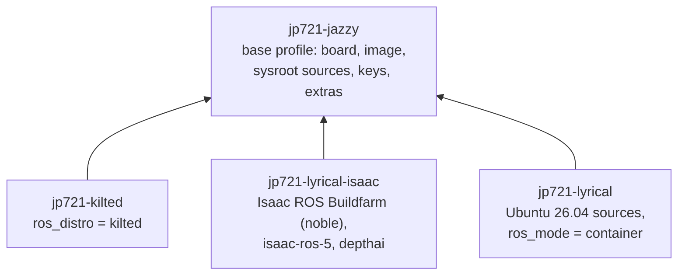

*Figure 2: Profile inheritance. Each child overrides only what differs.*

| Profile | ROS 2 | Userland | On a stock JetPack 7.2.1 board |
|---|---|---|---|
| `jp721-jazzy` | Jazzy | Ubuntu 24.04 | the board's own ROS |
| `jp721-kilted` | Kilted | Ubuntu 24.04 | shipped to `~/jxb/jp721-kilted/runtime`, or container |
| `jp721-lyrical-isaac` | Lyrical (NVIDIA Isaac ROS Buildfarm) + Isaac ROS 5.0 | Ubuntu 24.04 | shipped, or container |
| `jp721-lyrical` | Lyrical | Ubuntu 26.04 | container only (glibc 2.43) |

The resolved profile is written into the sysroot (`.jxb/profile.json`) when the sysroot is built. All later steps
read the profile from there, so a sysroot and the settings it was built with can never diverge (Section 5.2).

### 3.4 Design principles

1. **Same repositories, same versions.** The sysroot is installed from the repositories, keys and pins the board
   itself uses (`nvidia-l4t-apt-source`), so the package versions are the board's by construction.
2. **Extract, do not execute.** Packages are unpacked; the few maintainer-script effects that matter for compiling
   and linking are reproduced in Python. No QEMU, no root, no board.
3. **Host paths everywhere.** Workspaces and the sysroot are mounted into the container at their host paths, so
   `compile_commands.json`, debug info and error messages are valid on the host and in the container alike.
4. **The board is borrowed, not owned.** Everything jxb deploys lives under `~/jxb/`; what the board lacks is
   shipped next to the deployment, never installed system-wide.
5. **Every workflow is one non-interactive command** with a JSON form of its result (`--json`, `summary.json`),
   so VS Code, scripts and a future GUI (JetsonPlanner) can drive the same code.
6. **Fail loudly and early.** Missing keys, unresolved rosdeps, unbuilt packages, missing libraries and wrong ELF
   attributes stop the workflow with a message that says what to do.

### 3.5 Anatomy of a session

The sequence below shows what happens between typing `jxb build` and reading a performance report; Sections 4 to 7
explain each step.

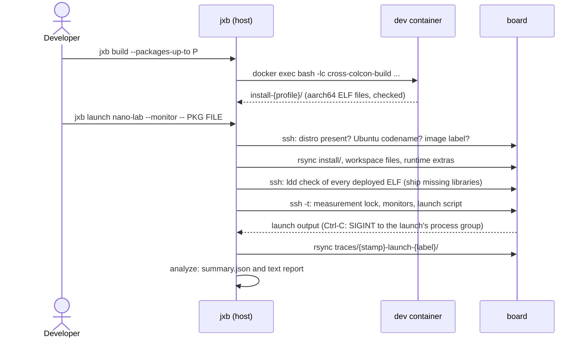

*Figure 3: A build, launch and analysis session.*

---

## 4. Deep dive I: the sysroot builder

### 4.1 Problem statement

The sysroot must contain the headers, libraries, CMake/pkg-config files and Python modules of every package the
workspace builds against, **in the board's versions**, and in a form the host toolchain can use. Copying it from a
board (problem P1) fails R1 and R4: the result depends on the board's history, and it requires a board. Installing
the packages into an arm64 chroot with `apt` under QEMU is reproducible but slow and needs root, because `dpkg` runs
maintainer scripts.

The observation behind the builder is that **compiling and linking only need the files of a package and very few
of its scripts' side effects**. Package resolution can be done by `apt` running natively on the host if `apt` is
told that arm64 is its native architecture; extraction is a `tar` operation; and the relevant script effects can be
enumerated (Section 4.5).

### 4.2 A private apt instance

`PrivateApt` creates a self-contained apt configuration under the profile's cache: its own `sources.list`
(the profile's `sources`, with downloaded keyrings substituted for `{nvidia_key}` etc.), its own preferences
(the board's pin), lists, archive cache and an **empty dpkg status file**. Pointing `APT_CONFIG` at the file below
makes `apt-get` believe it manages an empty arm64 system:

```text
Dir "<cache>/apt/";
Dir::State::status "<cache>/apt/var/lib/dpkg/status";      # empty: nothing is installed
Dir::Cache::Archives "<deb-cache>/";                       # shared between profiles
APT::Architecture "arm64";
APT::Architectures { "arm64"; };
APT::Install-Recommends "false";
APT::Install-Suggests "false";
Debug::NoLocking "true";                                   # no root needed
```

Two details are easy to get wrong. First, apt's `signed-by` decides the key format by file extension (`.asc` for
ASCII-armored, `.gpg` for binary), while the ROS key is a binary keyring served with a neutral name; the builder
therefore names downloaded keys by their content (F16). Second, the pin must be exactly the board's: NVIDIA's
packages win with priority 600, except that the profiles pin Ubuntu's `libopencv-dev` at 700, because ROS
`cv_bridge` links Ubuntu's OpenCV 4.6 and mixing it with NVIDIA's 4.8 made every `cv_bridge` node load two OpenCV
versions (F17).

> [!NOTE]
> The preference block is copied from `nvidia-l4t-apt-source`, the package that configures apt on a JetPack board.
> This is what makes "same repositories, same versions" hold: apt applies identical inputs to identical candidates.

### 4.3 Resolving the closure

The requested packages are the union of the profile's package sets (`sysroot/sets/*.txt`, `{ros_distro}`
substituted) and the workspace set generated by `jxb-rosdeps` (Section 4.9). Resolution uses apt's own solver in
simulation mode, and the selected packages are parsed from its output:

```python
INST_RE = re.compile(r"^Inst (\S+) (?:\[\S+\] )?\((\S+) .*\[(\S+)\]\)")

def resolve(self, packages: list[str]) -> list[tuple[str, str, str]]:
    out = self.apt("-s", "install", *packages, capture=True)
    sel = [m.groups() for m in map(INST_RE.match, out.splitlines()) if m]   # (name, version, arch)
    ...
```

A line of the form `Inst libnvinfer10 (10.16.2.10-1+cuda13.2 <origin> [arm64])` yields name, version and
architecture. Because the dpkg status is empty, the simulation returns the **complete transitive closure**, between
944 (Jazzy) and 1100 (Lyrical on 26.04) packages. `apt-get install --download-only` then fetches exactly these
files into a `.deb` cache shared by all profiles (9.6 GB for four profiles; the first profile downloads about
8 GB).

Packages of a workspace set that no configured repository provides (for example `depthai` for Lyrical on Ubuntu
24.04) are removed with a warning before resolution (`apt-cache policy` shows no candidate), so one missing
optional dependency does not fail the whole sysroot.

### 4.4 Extraction

Each `.deb` is an `ar` archive with a `control.tar` and a `data.tar`. The builder streams the data archive into the
staging directory and keeps the control files (maintainer scripts) for Section 4.5:

```python
def extract_deb(deb: Path, dest: Path, scripts_dir: Path) -> str:
    data = subprocess.Popen(["dpkg-deb", "--fsys-tarfile", str(deb)], stdout=subprocess.PIPE)
    tar = subprocess.run(["tar", "-x", "-C", str(dest), "--keep-directory-symlink", "--no-same-owner",
                          "--warning=no-timestamp", "-f", "-"], stdin=data.stdout, ...)
    ...
    run(["dpkg-deb", "-e", str(deb), str(ctrl_dir)])
    return (ctrl_dir / "control").read_text()
```

`--keep-directory-symlink` matters because Ubuntu uses a **merged `/usr`**: `/lib`, `/bin` and `/sbin` are symlinks
into `/usr`. The builder creates these links first (`ensure_merged_usr`), and `tar` must follow them instead of
replacing them with directories; otherwise `/lib/aarch64-linux-gnu` and `/usr/lib/aarch64-linux-gnu` would become
two different directories. Extraction runs in a thread pool (one job per CPU); a full sysroot is extracted in about
a minute from the cache.

### 4.5 Emulating maintainer scripts

`dpkg` runs `preinst`/`postinst` scripts that may create files the build needs. Executing them is exactly what jxb
avoids (it needs arm64 binaries, hence emulation, and often root). Instead, the builder reproduces the four effects
that matter for building and linking:

1. **The dpkg status database.** Some build tools ask dpkg what is installed. The builder writes every control
   paragraph with `Status: install ok installed` into `var/lib/dpkg/status`.
2. **`update-alternatives` links.** Many `-dev` packages register alternatives (for example BLAS/LAPACK and
   `cpp`). The builder parses literal `update-alternatives --install LINK NAME PATH PRIO [--slave ...]` calls from
   all `postinst` scripts, keeps for each `NAME` the candidate with the highest priority whose `PATH` exists, and
   creates `LINK → /etc/alternatives/NAME → PATH`, as `update-alternatives` would in automatic mode.
3. **Literal `ln -s` in `postinst`.** CV-CUDA and VPI create their CMake config links and `ld.so.conf.d` entries
   with plain `ln -s`, partly through shell variables (F13). The builder replays `ln -s SRC DEST` lines, expanding
   variables that the script assigns literally (`VAR="..."`); a line with an unknown variable is skipped rather than
   guessed.
4. **The GPU driver variant.** At boot, JetPack's `nv-load-gpu-libs.sh` publishes the active CUDA driver variant
   (F26). The builder writes the same `/etc/ld.so.conf.d/000-nvidia-gpu-libs.conf` and the
   `libcuda.so{,.1}` links for the profile's `gpu_variant` (Orin: `nvgpu`).

Finally, CUDA 13 on Orin uses `targets/sbsa-linux`, but CMake versions before 4 only look for
`targets/aarch64-linux` when cross-compiling for aarch64, so the builder adds that alias (F2).

> [!TIP]
> The selection rule for alternatives is the only non-trivial part. For a link group $g$ with candidates
> $c_i = (\text{path}_i, \text{prio}_i)$, the builder chooses
> $c^\star = \arg\max_{c_i : \text{path}_i \in \text{sysroot}} \text{prio}_i$, which is dpkg's *auto* mode. The
> board can still differ if someone selected an alternative manually; F43 is such a case (OpenBLAS in the sysroot,
> reference BLAS on the board). Same soname, so programs run, but gdb shows wrong symbols for these libraries.

### 4.6 Relative symlinks

Packages contain absolute symlinks such as `/usr/lib/aarch64-linux-gnu/libfoo.so → /usr/lib/aarch64-linux-gnu/libfoo.so.1`.
Inside the sysroot on the host, such a link points into the **host's** `/usr`, which silently links host libraries.
`relativize_symlinks` rewrites every absolute link target $t$ of a link at directory $d$ into

$$
t' = \operatorname{relpath}\big(\text{root} \oplus t,\; d\big),
$$

where $\oplus$ joins the sysroot root and the board path. The links then resolve inside the sysroot on the host and
still resolve correctly if the tree is used as a root file system (the runtime image, Section 6.5).
`rel_symlink`, used for alternatives and replayed links, computes the relative path against the *physical* parent
directory, because `/lib/cpp` physically lives in `usr/lib` once `lib → usr/lib`.

### 4.7 Fixups

A few sysroot files are correct on the board but break when used from the host. They are patched by declarative
rules in [`sysroot/fixups.toml`](../sysroot/fixups.toml); each rule names the file, a search string, the
replacement and the reason:

| Rule | Why it is needed |
|---|---|
| `rosidl_adapt_interfaces.cmake`: `file(STRINGS ... ENCODING UTF-8)` | without the encoding, CMake splits lines at non-ASCII bytes, so any workspace under a path like `.../HochschuleMünchen/...` fails to generate interfaces (F11, a ROS 2 bug) |
| `acados_template`: return after building if `JXB_CROSS_BUILD` is set | acados generates, compiles and then `dlopen()`s the solver; an aarch64 library cannot be loaded by the x86 build process, and the failed load deleted the just-built library (F20) |
| CUB `device_transform.cuh`, `tuning_transform.cuh`: specialization inside its namespace | a CUDA 13.2 bug ([NVIDIA/cccl#8833](https://github.com/NVIDIA/cccl/issues/8833)): GCC 13/14 reject the qualified class-head name that nvcc's front end emits; it breaks ONNX Runtime's CUDA EP, also natively (F22) |

### 4.8 Extras

Some software is not available as a suitable apt package and is installed from other sources:

- **ONNX Runtime 1.31 with CUDA and TensorRT execution providers for `sm_87`.** The released aarch64 CUDA EP plugin
  contains code only for `sm_89/90a/120a/121a` and no PTX, so it cannot run on Orin (F8). jxb cross-builds ORT
  ([`extras/onnxruntime/build.sh`](../extras/onnxruntime/build.sh)) in a "lean" flavour that keeps the contrib
  operators (required by the TensorRT EP) but drops the LLM-specific kernel families; a full build was estimated at
  about 7 h on the 20-core workstation (F24), the lean one is practical. The sysroot picks the local build up automatically when it exists, else the CPU
  release tarball; the release's CMake config expects `lib64/` and `include/onnxruntime/`, which the builder adds
  as links (F9).
- **CV-CUDA 0.16** from its release `.deb` files (by URL), **acados 0.5.2** and **depthai 3.10** cross-built by
  jxb (depthai through vcpkg with an overlay triplet that chainloads the jxb toolchain, F34, F40).

### 4.9 Package sets and workspace dependencies

The sysroot content is declared in package sets:

| Set | Content |
|---|---|
| `base-dev` | `build-essential` (libc and libstdc++ headers, CRT files), Python headers and numpy, Eigen, yaml-cpp, Boost, OpenSSL, zlib, protobuf, ... |
| `runtime-base` | Ubuntu's *Essential* packages (`bash`, `coreutils`, `findutils`, `grep`, ...), which apt never pulls in as dependencies but a container needs (F48) |
| `jetpack-7.2.1-dev` | CUDA 13.2 libraries and the target headers `nvcc` needs (pinned versions), cuDNN, TensorRT, VPI, ... |
| `l4t-driver` | `nvidia-l4t-core`, `nvidia-l4t-cuda`, the `nvgpu` CUDA driver |
| `ros-dev` | `ros-{ros_distro}-ros-base`, generators, Cyclone DDS, `cv_bridge`, `image_transport`, message packages, `tf2_ros`, ... |
| `isaac-ros-5`, `depthai-deps` | optional: Isaac ROS 5.0 packages; system dependencies of depthai |

Workspace dependencies are collected by `jxb sysroot rosdeps -w WS`, which runs
[`jxb-rosdeps`](../toolchain/bin/jxb-rosdeps) in the xbuild image. It resolves all `rosdep` keys of the workspace
for the board's Ubuntu release and ROS distribution, and **also scans launch files** for packages they start or
include:

```python
LAUNCH_PKG = re.compile(r"""\b(?:package|pkg)\s*=\s*["']([A-Za-z][A-Za-z0-9_]*)["']"""
                        r"""|(?:get_package_share_directory|FindPackageShare)\(\s*["']([A-Za-z][A-Za-z0-9_]*)["']""")
```

This was added after the shipped Kilted runtime failed with "package 'topic_tools' not found": the SAM launch
files start `topic_tools`, `rplidar_ros`, `mavros`, `robot_state_publisher` and include `foxglove_bridge`, but no
`package.xml` declares them. On a developer PC with a full ROS install this goes unnoticed; on a board runtime
made from the sysroot it does not (F52, F60). GUI tools and simulators are excluded from the scan. Keys that do not
resolve are an error; for a distribution built for another Ubuntu release (Lyrical on 24.04) keys are retried
against the release it targets and accepted only if they map to `ros-<distro>-*` packages (F31).

### 4.10 Metadata and the swap

The builder writes metadata into `<sysroot>/.jxb/`:

| File | Content | Used by |
|---|---|---|
| `packages.lock` | `name=version` of every package | `jxb board check` (compare with the board) |
| `sources.list` | the exact apt sources | audit |
| `info.json` | build time, counts, applied alternatives, links, extras with SHA-256, fixups | runtime image label, `jxb sysroot info` |
| `profile.json` | the fully resolved profile | `env.sh`, `cross-colcon-build`, extras |

The sysroot is assembled in `<name>.staging` and swapped in by renaming, so an interrupted build never leaves a
half-written sysroot behind. Because a running dev container still sees the old (now deleted) directory through its
bind mount, `jxb sysroot build` recreates the container with the same workspaces (F14).

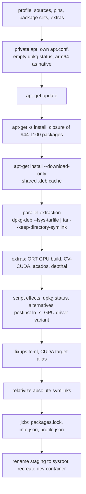

*Figure 4: The sysroot build pipeline.*

### 4.11 Properties

- **Determinism.** For fixed repository contents, the output is a function of the profile; `packages.lock`
  documents it, and `jxb board check` compares it with a board. Over time the repositories advance (the board
  synced in June had `rclcpp` 28.1.21, the sysroot 28.1.22; the board's cuDNN was 9.25, JetPack's 9.20, F35);
  these patch-level differences are ABI-compatible and shown as `DIFF`.
- **Cost.** About 8 GB download once, then about one minute per rebuild from the cache; 16-19 GB per sysroot.
- **No privileges.** Neither root nor a board nor emulation is required.

---

## 5. Deep dive II: the cross toolchain

### 5.1 The xbuild image

[`docker/xbuild.Dockerfile`](../docker/xbuild.Dockerfile) builds a host-tools-only image (~3.4 GB) per profile, on
the board userspace's Ubuntu release (24.04, or 26.04 for `jp721-lyrical`). Its layers are:

1. Base build tools and the distribution's `gcc-aarch64-linux-gnu`/`g++-aarch64-linux-gnu` (GCC 13 on 24.04),
   i.e. the default compiler of the board's Ubuntu release; `qemu-user` for optional smoke tests.
2. ROS 2 on the host (`ros-<distro>-ros-base`, the rosidl generators, `ros-dev-tools`) for the code generators.
3. NVIDIA's **x86_64 `nvcc` of exactly the board's version** (`cuda-nvcc-13-2=13.2.86-1`), held at that version.
4. Build-time generators that the SAM stack needs on the host: `acados_template`, casadi 3.7.2, the x86
   `t_renderer` (F20, F21).
5. A non-root user with the host's UID/GID, so files written into mounted workspaces keep their owner.

The jxb tree itself is **not** copied into the image but bind-mounted at `/opt/jxb`; edits to the toolchain take
effect without rebuilding the image.

The CUDA layer contains two deliberate modifications:

```dockerfile
RUN ... && cd /usr/local/cuda-${CUDA_DASH/-/.} \
    && ln -sfn targets/${CUDA_TARGET}/include include && ln -sfn targets/${CUDA_TARGET}/lib lib64 \
    && sed -i "1i _TARGET_DIR_ = targets/${CUDA_TARGET}" bin/nvcc.profile
ENV NVCC_CCBIN=aarch64-linux-gnu-g++
```

CMake's `FindCUDAToolkit` probes `nvcc -v` without any flags and then used the **x86_64** CUDA include directory
for C++-only targets (F5). Making the board's target directory nvcc's default, and the aarch64 compiler its default
host compiler, turns this toolkit into one that *only* targets the board: even a plain `nvcc x.cu` produces aarch64
code. The `targets/sbsa-linux` directory itself is empty in the image; the dev container bind-mounts the sysroot's
copy over it (Section 5.6), so device code is compiled against exactly the board's CUDA headers and libraries.

### 5.2 Deriving the environment

All board-specific values reach the toolchain through environment variables, and all of them are derived from one
place, the profile copy in the sysroot:

```bash
# toolchain/env.sh (sourced by every shell in the container)
if [ -n "${ARM64_SYSROOT:-}" ] && [ -f "${ARM64_SYSROOT}/.jxb/profile.json" ]; then
    while IFS= read -r _jxb_line; do
        _jxb_name=${_jxb_line#export }; _jxb_name=${_jxb_name%%=*}
        if [ -z "${!_jxb_name:-}" ]; then eval "${_jxb_line}"; fi     # variables already set win
    done < <(python3 "${JXB_HOME:-/opt/jxb}/toolchain/profile_env.py" "${ARM64_SYSROOT}/.jxb/profile.json")
    export JXB_TOOLCHAIN_FILE="${JXB_HOME:-/opt/jxb}/toolchain/orin.toolchain.cmake"
fi
```

`profile_env.py` maps the profile to `JXB_PROFILE`, `ROS_DISTRO`, `JXB_CPU_FLAGS` (`-mcpu=cortex-a78ae`),
`JXB_CUDA_ARCH` (`87`), `JXB_CUDA_VERSION` (`13.2`), `JXB_CUDA_TARGET` (`sbsa-linux`), `JXB_PYTHON_VERSION` and
`JXB_QEMU_CPU`. The container only needs `ARM64_SYSROOT`; everything else follows.

### 5.3 The CMake toolchain file

[`toolchain/orin.toolchain.cmake`](../toolchain/orin.toolchain.cmake) is the core of the cross build. It refuses to
run without the environment above, then configures five areas.

**Compilers and search roots.**

```cmake
set(CMAKE_SYSTEM_NAME Linux)
set(CMAKE_SYSTEM_PROCESSOR aarch64)
set(CMAKE_SYSROOT "$ENV{ARM64_SYSROOT}")
set(CMAKE_C_COMPILER aarch64-linux-gnu-gcc)
set(CMAKE_CXX_COMPILER aarch64-linux-gnu-g++)
# Append, never overwrite: toolchain files are read several times, and wrappers that chainload this file (vcpkg)
# add their own roots after the first read.
list(APPEND CMAKE_FIND_ROOT_PATH "${JXB_SYSROOT}")
if(DEFINED ENV{JXB_WS_INSTALL})                  # packages of the same colcon workspace
  string(REPLACE ":" ";" _jxb_ws "$ENV{JXB_WS_INSTALL}")
  list(APPEND CMAKE_FIND_ROOT_PATH ${_jxb_ws})
endif()
set(CMAKE_FIND_PACKAGE_RESOLVE_SYMLINKS ON)
set(CMAKE_FIND_ROOT_PATH_MODE_PROGRAM NEVER)     # programs: host tools
set(CMAKE_FIND_ROOT_PATH_MODE_LIBRARY ONLY)      # libraries, headers, packages: target only
set(CMAKE_FIND_ROOT_PATH_MODE_INCLUDE ONLY)
set(CMAKE_FIND_ROOT_PATH_MODE_PACKAGE ONLY)
```

`CMAKE_FIND_ROOT_PATH` re-roots every search into the sysroot. Packages built earlier in the same colcon run are
installed *outside* the sysroot, so the workspace install space is added as a second root. Two subtle bugs shaped
this block: the first version used `set()`, which lost vcpkg's roots on the second read of the file (F33); and in a
merged-`/usr` sysroot, a CMake config found through the `lib → usr/lib` link computed its install prefix as the
sysroot root, which `CMAKE_FIND_PACKAGE_RESOLVE_SYMLINKS` fixes (F39).

**Linker paths.** The board's dynamic loader finds transitive dependencies through `/etc/ld.so.conf.d` and
`LD_LIBRARY_PATH`; the cross linker does not read either. The toolchain therefore collects the sysroot's
`ld.so.conf.d` entries plus the directories that are only on the board's `LD_LIBRARY_PATH` (ROS, ONNX Runtime) and
passes each as `-Wl,-rpath-link`. `--sysroot` is repeated in the linker flags because CMake passes no sysroot flag
when the host compiler links CUDA targets (F6).

**pkg-config.** `PKG_CONFIG_LIBDIR` lists only the sysroot's `.pc` directories and `PKG_CONFIG_SYSROOT_DIR`
re-roots their paths; `PKG_CONFIG_PATH` is cleared so no host `.pc` file can leak in.

**Python.** The host interpreter runs the generators, but headers, `libpython` and the extension suffix must be
the board's. Without overriding the SOABI, extension modules would be named `*.cpython-312-x86_64-linux-gnu.so`
and would not import on the board:

```cmake
foreach(_jxb_p Python3 Python)
  set(${_jxb_p}_EXECUTABLE /usr/bin/python3 CACHE FILEPATH "Host Python for code generators")
  set(${_jxb_p}_INCLUDE_DIR "${JXB_SYSROOT}/usr/include/python${_jxb_py}" CACHE PATH "")
  set(${_jxb_p}_LIBRARY "${JXB_SYSROOT}/usr/lib/aarch64-linux-gnu/libpython${_jxb_py}.so" CACHE FILEPATH "")
  set(${_jxb_p}_SOABI "cpython-${_jxb_pynodot}-aarch64-linux-gnu" CACHE STRING "")
endforeach()
set(PYTHON_MODULE_EXTENSION ".cpython-${_jxb_pynodot}-aarch64-linux-gnu.so" CACHE STRING "")   # pybind11
```

**CUDA.**

```cmake
set(CMAKE_CUDA_COMPILER "/usr/local/cuda-$ENV{JXB_CUDA_VERSION}/bin/nvcc")
set(CMAKE_CUDA_HOST_COMPILER aarch64-linux-gnu-g++)
if(NOT DEFINED CMAKE_CUDA_ARCHITECTURES)
  set(CMAKE_CUDA_ARCHITECTURES "$ENV{JXB_CUDA_ARCH}")                  # 87
endif()
set(CMAKE_CUDA_FLAGS_INIT
  "--target-directory $ENV{JXB_CUDA_TARGET} -Xcompiler=--sysroot=${JXB_SYSROOT},${_jxb_cpu_xc}")
set(ENV{CUDA_TOOLKIT_ROOT} "${JXB_CUDA_ROOT}")                        # legacy FindCUDA (F31)
```

The last line exists because the legacy `FindCUDA` module, still used by `isaac_ros_common`, takes the cross
target directory only from an environment variable (F31).

### 5.4 What runs where

The table summarizes which machine each artefact of a build is for, which is the key to reasoning about any
cross-build error.

| Step | Program runs on | Reads | Produces for |
|---|---|---|---|
| `rosidl` / ament generators | host (x86 Python, host ROS) | `.msg`, templates | source code |
| C/C++ compile | host (`aarch64-linux-gnu-g++`) | sysroot headers | board (aarch64 objects) |
| CUDA device compile | host (x86 `nvcc`) | sysroot `targets/sbsa-linux` | board GPU (`sm_87` SASS) |
| CUDA host compile | host (aarch64 GCC via `-ccbin`) | sysroot headers | board |
| link | host (`aarch64-linux-gnu-ld`) | sysroot libraries, `-rpath-link` | board |
| acados solver codegen | host (casadi, x86 `t_renderer`) | board headers | C code, then compiled for the board |
| TensorRT engine build | **board** (engines are device- and version-specific) | ONNX model | board |

### 5.5 `cross-colcon-build`

The wrapper ([`toolchain/bin/cross-colcon-build`](../toolchain/bin/cross-colcon-build)) is what `jxb build` runs in
the container. It

1. sources `env.sh` and refuses to run without a jxb sysroot;
2. partitions its arguments into colcon and CMake arguments (CMake's own long options such as `--fresh` stay
   CMake's) and forbids overriding `CMAKE_TOOLCHAIN_FILE`;
3. adds defaults unless given (`CMAKE_BUILD_TYPE=Release`, `BUILD_TESTING=OFF`,
   `CMAKE_EXPORT_COMPILE_COMMANDS=ON`);
4. uses per-profile trees `build-<profile>/` and `install-<profile>/`, so one workspace can be built for several
   distributions side by side;
5. sources `ros-cross-env.sh`: host ROS Python modules first, the sysroot's (pure Python) as a fallback,
   `AMENT_PREFIX_PATH`/`CMAKE_PREFIX_PATH` pointing at the sysroot's `/opt/ros/<distro>`, `CC`/`CXX` set to the board
   compiler for build steps that compile without CMake (acados' generated Makefiles), and `JXB_CROSS_BUILD=1`;
6. after the build, **rewrites build-time paths** and repairs ELF files:

```bash
# colcon's setup scripts and ament's parent_prefix_path index record the build-time underlay, i.e. the sysroot's
# copy of /opt/ros/<distro>. On the board that is plain /opt/ros/<distro>.
{ find "${install_base}" -maxdepth 1 -type f -name 'setup.*'
  find "${install_base}" -type f -path '*/share/ament_index/resource_index/parent_prefix_path/*'
} | xargs -r sed -i "s#${ARM64_SYSROOT}/#/#g"
"$(dirname "$(realpath "$0")")/jxb-fix-needed" "${install_base}"
```

### 5.6 The dev container

`jxb up` creates a long-lived container `jxb-<profile>` from the xbuild image with these mounts:

| Mount | Source | Target | Mode |
|---|---|---|---|
| jxb tools | repository | `/opt/jxb` (and its own path) | ro |
| sysroot | `sysroots/<profile>` | same path | ro |
| CUDA target | `<sysroot>/usr/local/cuda-13.2/targets/sbsa-linux` | `/usr/local/cuda-13.2/targets/{sbsa,aarch64}-linux` | ro |
| board paths | `<sysroot>/opt/onnxruntime`, `<sysroot>/opt/acados` | `/opt/onnxruntime`, `/opt/acados` | ro |
| workspaces | each workspace | **same path** | rw |
| ccache | volume `jxb-ccache-<profile>` | `~/.ccache` | rw |

The "board paths" mapping exists because SAM's `object_detection_package` hard-codes `/opt/onnxruntime`, a board
path (F10). Mounting workspaces at their host paths means the absolute paths in `compile_commands.json` and in DWARF
debug information are valid on the host, so clangd and gdb work there without path maps.

### 5.7 Verifying binaries

Two tools inspect every cross-built ELF file.

[`jxb-elfcheck`](../toolchain/bin/jxb-elfcheck) parses `readelf` output and checks, for each file: the machine
type is AArch64; the interpreter is `/lib/ld-linux-aarch64.so.1`; no `RUNPATH`/`RPATH` entry contains a host path
(`/home/`, `/tmp/`, `x86_64-linux`); every `DT_NEEDED` entry resolves the way it will on the board (`RUNPATH`, the
install tree's library directories, the sysroot's linker paths); no `DT_NEEDED` is an absolute path; and every
required symbol version (`GLIBC_*`, `GLIBCXX_*`, ...) is defined by the library it resolves to. The last check
catches objects that were compiled against the cross compiler's own libc or libstdc++ instead of the board's
(Ubuntu's cross GCC searches its tooldir before the sysroot, F7).

[`jxb-fix-needed`](../toolchain/bin/jxb-fix-needed) repairs a defect that the linker produces legitimately: a shared
library *without* `SONAME` that is linked by its full path is recorded by that path, here
`<sysroot>/opt/ros/lyrical/lib/libtensor_rt_node.so` (Isaac ROS exports its node libraries this way, F44). The fix
exploits a property of the ELF string table: the file name is a **suffix** of the recorded path, and `.dynstr`
strings are NUL-terminated, so pointing the `DT_NEEDED` entry at the offset of the suffix yields the file name
without moving any byte:

$$
\text{off}' = \text{off} + |\text{path}| - |\text{basename}(\text{path})|.
$$

The tool walks `PT_DYNAMIC`, translates virtual addresses to file offsets through the `PT_LOAD` segments, rewrites
matching `DT_NEEDED` entries and the `vn_file` fields of `.gnu.version_r` that name the same library (the loader
matches version needs against the name it loaded the library by), and writes the file in place. No `patchelf`, no
section resizing.

### 5.8 The test suite

`jxb test` cross-builds and checks a set of probe projects that cover every layer
([`tests/run.sh`](../tests/run.sh)): CUDA with relocatable device code and cuBLAS (`cuda_hello`), a TensorRT
engine build and inference (`trt_smoke`), ONNX Runtime CPU/CUDA/TensorRT EP (`ort_smoke`, `ort_bench`), the ONNX
library built from source (`onnx_lib`), a ROS 2 workspace with a custom interface and a CUDA/TensorRT/`cv_bridge`
node (`ros_ws`), and for Isaac profiles a node using Lyrical's `rosidl::Buffer` CUDA backend (`isaac_ws`). On the
host the stage is checked with `jxb-elfcheck`, the Python extension suffix check and runs under
`qemu-aarch64 -cpu cortex-a76` (the closest QEMU model to the Cortex-A78AE; QEMU 10's default model raises
`SIGILL` on such code, F25). `jxb test --board B` copies the stage to `~/jxb/<profile>/tests` and runs it on the GPU.
The parsers of the trace analysis have their own unit tests (`tests/trace`).

---

## 6. Deep dive III: deployment and the board runtime

### 6.1 The board model

Boards are listed in `boards.toml` (local, not committed) with host, user, optional SSH port, deploy directory and
tool overrides. All SSH calls use keys only (`BatchMode=yes`; a failed login prints the `ssh-copy-id` command),
`ConnectTimeout=8` and `StrictHostKeyChecking=accept-new`. Everything jxb writes lives under one directory per
profile:

```text
~/jxb/
├── .measure.lock, .measure.lock.info   measurement lock (flock) and its current holder
├── trt_cache/                          ONNX Runtime TensorRT EP engine cache (benchmarks)
└── <profile>/                          everything deployed for this profile; deletable at any time
    ├── <ws>/                           a deployed workspace (exported as WORKSPACE_ROOT)
    │   ├── install/                    install-<profile>/ from the host
    │   ├── launch/  assets/            workspace files
    │   └── src/<pkg>/{launch,config,params,urdf}/
    ├── runtime/
    │   ├── opt/ros/<distro>/           shipped ROS distribution (only if the board lacks it)
    │   ├── opt/onnxruntime/ opt/acados/  runtime extras ([deploy] runtime)
    │   ├── pydist/                     Python modules the board's Python lacks
    │   └── syslibs/                    shared libraries the board lacks
    ├── tools/                          board helpers (synthetic camera, bag → CSV, ftrace, benchmark)
    ├── tests/  bench/                  test stage, benchmark binaries, models and engines
    └── traces/                         recordings in progress (fetched to the host, then removed)
```

### 6.2 Deploying a workspace

`deploy_workspace` ([`jxb`](../jxb)) performs, in order:

1. **Board preparation** (`prepare_board`): in container mode, make sure the runtime image is on the board;
   natively, ship the ROS distribution if the board does not have it (Section 6.3).
2. **Incomplete packages.** A package that failed to build still leaves an install directory, because colcon
   writes `share/<pkg>/package.dsv` before building; its hooks name `local_setup.*` files that were never installed,
   and sourcing the workspace on the board then stops at it (F57). `incomplete_packages` finds such packages by
   checking that every `source;` hook in `package.dsv` exists; they are not deployed and stale copies are removed.
3. **The install space**, fully (`rsync --delete`) or only the requested `--packages` plus colcon's top-level setup
   files, with rsync filter rules (`--include=/<pkg>/*** --include=/*.* --include=/_* --exclude=/*`).
4. **Workspace files** needed at run time but not installed: `launch/`, `assets/` and the `launch`, `config`,
   `params`, `urdf` folders of packages. Files that are only **Git LFS pointers** (smaller than 1 KiB and starting
   with `version https://git-lfs.github.com/spec/`) are excluded, after a pointer once replaced the real model on
   the board ("Protobuf parsing failed", F51).
5. **Runtime extras** (`[deploy] runtime`): jxb's ONNX Runtime GPU build and acados go to
   `~/jxb/<profile>/runtime/opt/...`, never into the board's `/opt`.
6. **Library closure check** (`ensure_board_libs`, below).

### 6.3 Making a stock board run another ROS distribution

The board runs Jazzy; Kilted and Lyrical (Buildfarm) must run without touching `apt` (R4, R5). Two observations make
this possible. First, ROS 2's setup scripts derive their prefix from their own location, so the sysroot's
`/opt/ros/<distro>` is **relocatable**: copied to `~/jxb/<profile>/runtime/opt/ros/<distro>` (without headers and
static libraries: 191 MB for Kilted, 226 MB for Lyrical with Isaac ROS), it runs from there (F44). This requires the
same Ubuntu release, which `ship_ros` checks against the board's `VERSION_CODENAME`. Second, the remaining gaps can
be found mechanically:

- **Python modules.** Lyrical takes `osrf_pycommon` from the system package `python3-osrf-pycommon`, which the board
  has only inside `/opt/ros/jazzy`, so `ros2 launch` failed (F61). `ship_pydist` compares the sysroot's
  `dist-packages` with the modules the board's Python can import (`pkgutil.iter_modules()`) and ships the
  difference to `runtime/pydist`, appended to `PYTHONPATH`.
- **Shared libraries.** `ensure_board_libs` runs a script on the board that prints `HAVE <file>` for every library
  under the deployed directories and `MISSING <soname>` for every library that `ldd` cannot resolve for any deployed
  ELF file. Missing libraries are copied from the sysroot to `runtime/syslibs`, which is on `LD_LIBRARY_PATH`, and
  the check is repeated, because shipped libraries can have dependencies of their own. Formally, with $D$ the
  deployed ELF files, $S_k$ the shipped set after iteration $k$ and $\mathrm{miss}(X)$ the unresolved sonames of
  $X$,
  $$
  S_0 = \emptyset,\qquad S_{k+1} = S_k \cup \mathrm{miss}(D \cup S_k),
  $$
  iterated until $\mathrm{miss}(D \cup S_k) = \emptyset$ (at most five rounds). A soname that is not in the sysroot
  either is an error. In practice the board lacked no system library for Kilted or Lyrical on 24.04; the mechanism
  is what makes that a checked fact instead of an assumption.

### 6.4 The board environment

Every remote command is prefixed by a generated shell snippet (`board_env_script`) whose order matters:

```bash
set +u; export PYTHONPATH=${PYTHONPATH:+$PYTHONPATH:}~/jxb/P/runtime/pydist;            # native only
export JXB_ROS_SETUP=/opt/ros/D/setup.bash; [ -f $JXB_ROS_SETUP ] ||
    JXB_ROS_SETUP=~/jxb/P/runtime/opt/ros/D/setup.bash; source $JXB_ROS_SETUP &&          # 1. underlay
if [ -f ~/jxb/P/WS/install/local_setup.bash ]; then source ~/jxb/P/WS/install/local_setup.bash; fi &&   # 2.
export LD_LIBRARY_PATH=~/jxb/P/runtime/opt/onnxruntime/lib:~/jxb/P/runtime/opt/acados/lib:\
~/jxb/P/runtime/syslibs:$LD_LIBRARY_PATH &&                                               # 3. extras first
export WORKSPACE_ROOT=~/jxb/P/WS && export ROS_AUTOMATIC_DISCOVERY_RANGE=LOCALHOST && ... # 4. jxb.toml env
```

(`P` = profile, `D` = distribution, `WS` = workspace; the real script uses absolute paths.) The underlay is sourced
explicitly and the workspace through `local_setup.bash`, not `setup.bash`, because the recorded underlay path may not
exist on the board. jxb's ONNX Runtime comes first on `LD_LIBRARY_PATH`, so it wins over the board's own CPU-only
`/opt/onnxruntime` (F38). `set +u` is needed because ROS setup scripts reference unset variables (F37).

### 6.5 Native and container mode

`uses_container` decides where board commands run: an explicit `--mode native|container` (or `mode` in
`jxb.toml`) wins; otherwise a profile can force it (`[deploy] container`); otherwise the container is used exactly
when the profile's Ubuntu release differs from the board's. `board_exec` then wraps the script:

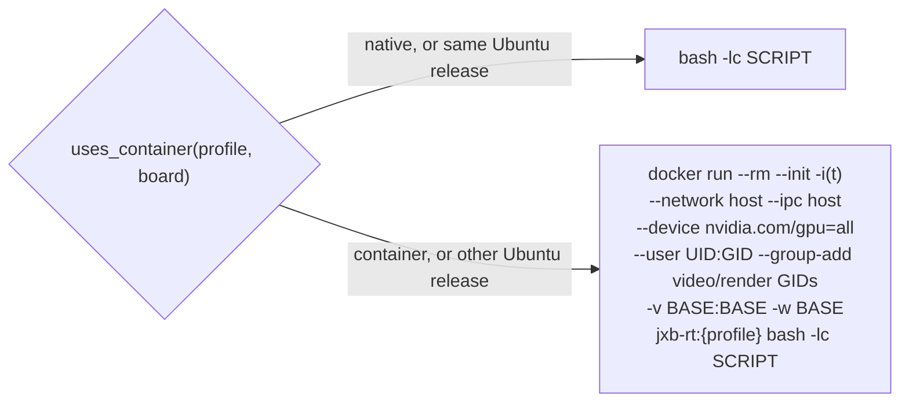

*Figure 5: Native and container execution of the same script.*

The **runtime image** is created on the host, without emulation, by streaming the sysroot into `docker import`:

```python
tar = subprocess.Popen(["tar", "-C", str(p.sysroot), "-c", "--numeric-owner",
                        *(f"--exclude={x}" for x in RUNTIME_IMAGE_EXCLUDES), "."], stdout=subprocess.PIPE)
sh(["docker", "import", "--platform", "linux/arm64", "--change", f"LABEL jxb.profile={p.name}",
    "--change", f"LABEL jxb.sysroot.built={built}", "--change", 'CMD ["bash"]', "-", tag], stdin=tar.stdout)
```

The excludes drop headers, static libraries, documentation, the CUDA compiler and the TensorRT builder resources for
GPU architectures other than the one Orin's TensorRT loads, which gives 10.2-10.8 GB images. The label carries the
sysroot's build time; the board's copy is replaced only when the label differs, by streaming
`docker save | zstd -T0 -3 | ssh 'zstd -d | docker load'` and removing the previous image.

The `docker run` flags encode several findings:

| Flag | Reason |
|---|---|
| `--device nvidia.com/gpu=all` | the GPU through the board's CDI specification (JetPack's container toolkit mounts the host's CUDA driver and libraries) |
| `--group-add <GID>` of `video`, `render` | GPU device nodes belong to these groups; by **number**, since the image (a sysroot) has no such group names (F48) |
| `--network host --ipc host` | DDS discovery and shared-memory transport with nodes outside the container |
| `-v BASE:BASE -w BASE` | the deployment at the same path as natively, so the same scripts and paths work in both modes |
| `--user $(id -u):$(id -g)`, `-e HOME=BASE` | files written by the container belong to the board user; `HOME` is writable |
| `--init`, `-t` with a terminal | signals and hang-ups reach the processes; closing the connection stops the container |
| optional `-v /usr/bin/gdbserver`, `-v /opt/nvidia/nsight-systems` | the board's debugger and profiler inside the container |

> [!IMPORTANT]
> The Ubuntu 26.04 userland of `jp721-lyrical` runs with the CUDA driver and libraries of the 24.04 host. This is
> sound because the container toolkit mounts the host's driver stack and newer glibc versions are backward
> compatible with libraries built for older ones; NVIDIA publishes no CUDA 13.2 or TensorRT for 26.04/sbsa (F23).

### 6.6 Launch mode

`jxb launch BOARD [options] -- TARGET [ARGS]` is the Renesas-style remote launch: deploy, start a launch file on
the board, stop it cleanly. `TARGET` is either `PKG FILE` or a launch file of the workspace (for SAM:
`launch/launch.py module:=parking`), which is mapped to its deployed copy. The command composes three layers of
shell (Figure 6):

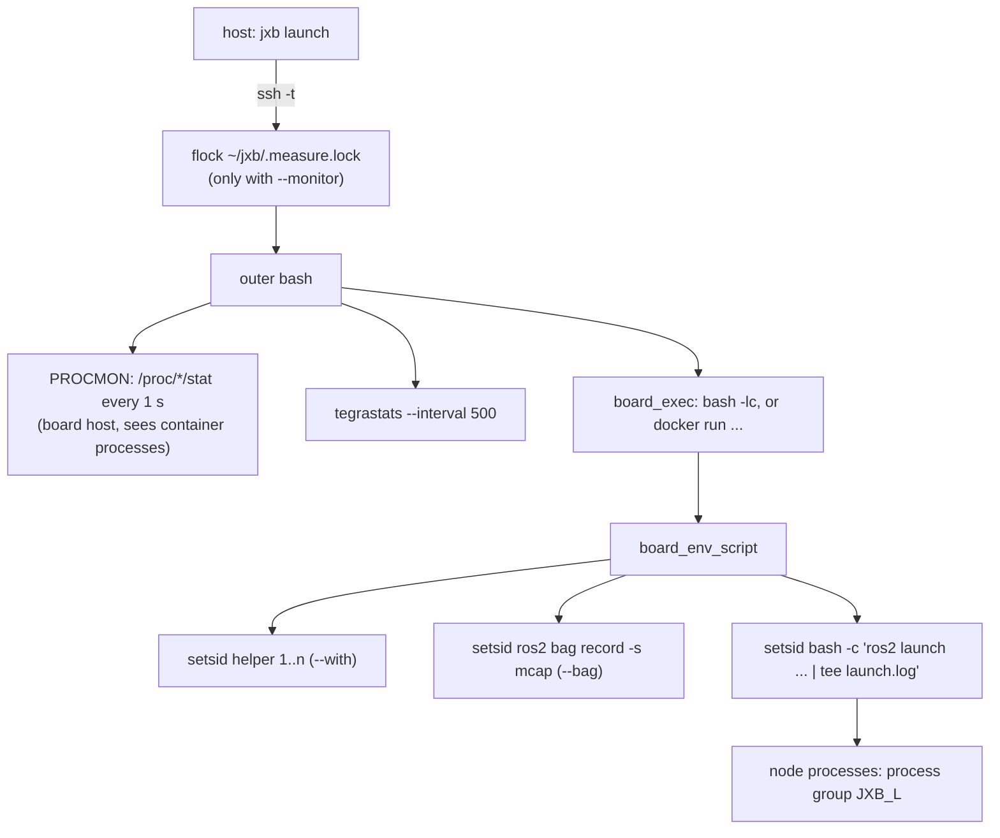

*Figure 6: Process structure of `jxb launch --monitor --bag --with ...`.*

The difficult part is **lifecycle management**. A remote launch must stop completely on Ctrl-C, on `--duration`,
on a lost connection, and when `ros2 launch` itself dies, and it must never stop processes that do not belong to it.
Earlier versions failed in instructive ways (F58, F62): nodes of a launch that died early kept running and blocked
`nsys` for 15 minutes; a sweep with `pkill -f <deploy path>` also killed jxb's own wrapper shells, whose command lines
contain that path; and a leftover `tegrastats` held the SSH channel open. The final design relies on POSIX
process groups:

```bash
# helpers, the recorder and the launch each in their own session; $! is the group id
setsid bash -c "$HELPER" > with0.log 2>&1 & groups="$groups $!"
setsid ros2 bag record -s mcap -o bag TOPICS > bag.log 2>&1 & JXB_BAG=$!
setsid bash -c 'ros2 launch ... 2>&1 | tee -i launch.log; exit ${PIPESTATUS[0]}' & JXB_L=$!
echo $JXB_L > pgid
trap 'kill -INT -- -$JXB_L 2>/dev/null' INT TERM HUP        # forward Ctrl-C and hang-ups to the launch
wait $JXB_L; rc=$?; while kill -0 $JXB_L 2>/dev/null; do wait $JXB_L; rc=$?; done
trap - INT TERM HUP
for g in $groups; do kill -TERM -- -$g 2>/dev/null; done      # helpers: SIGTERM
kill -TERM -- -$JXB_BAG; wait $JXB_BAG; python3 tools/jxb_bag_csv.py bag   # bag closed, numeric topics as CSV
sleep 1; for g in $JXB_L $groups; do kill -KILL -- -$g 2>/dev/null; done   # sweep leftovers
touch .done; exit $rc
```

Three POSIX details are essential. `setsid` does not fork for a background job of a non-interactive shell, so `$!`
is both the PID and the new process group ID, and `kill -- -PGID` reaches every process of that tree, including
nodes whose `ros2 launch` parent is gone. Background jobs of a non-interactive shell ignore SIGINT, which is why
helpers are stopped with SIGTERM. And `wait` returns early when a trapped signal arrives, hence the loop. Without a
terminal (VS Code, scripts) a local Ctrl-C cannot reach the board's process group through SSH; jxb catches the
`KeyboardInterrupt` and sends SIGINT to the recorded group (through `docker exec` in container mode, since the PID
belongs to the container's namespace), then waits for `.done` before fetching the recording. Exit codes 0, 124
(`timeout`), 130 and -2 (SIGINT) count as a normal end.

`--with` starts helpers in the same environment and mode, for example the synthetic camera
[`jxb_image_pub.py`](../tools/board/jxb_image_pub.py), which renders a road scene with lane markings and moving
objects and publishes `sensor_msgs/Image` (and optionally a matching `CameraInfo`) at a fixed rate, so perception
nodes can be exercised without hardware. `--bag` records MCAP; afterwards
[`jxb_bag_csv.py`](../tools/board/jxb_bag_csv.py) exports numeric topics (and header-stamp latencies) as CSV for
the analysis.

### 6.7 Remote debugging

`jxb debug BOARD --pkg P --exe E` starts `gdbserver --once 127.0.0.1:PORT` on the board and reaches it through a
local port forward of the same SSH connection, so nothing listens on the lab network and no firewall rule is needed:

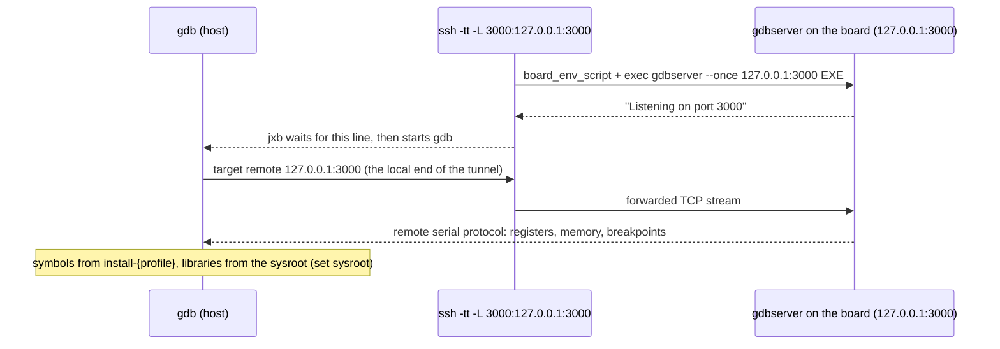

*Figure 7: SSH-tunnelled remote debugging.*

gdb is configured with `set sysroot <sysroot>` (target libraries with symbols), `solib-search-path` over the
workspace's library directories and the runtime extras, `debuginfod` off and pending breakpoints on. The host's gdb
is used if it supports aarch64 (Arch-based distributions build it with `--enable-targets=all`), otherwise
`gdb-multiarch` in the container. `-tt` gives the remote side a terminal, so closing the connection hangs up
everything it started (F42). With `--launch PKG FILE`, the node is started by its launch file and only the selected
executable runs under gdbserver, via `ros2 launch ... --launch-prefix 'gdbserver ...' --launch-prefix-filter '^E$'`.
Attaching to a running node is not offered: the board has `kernel.yama.ptrace_scope=1`, which would require root.

---

## 7. Deep dive IV: observability

### 7.1 Recording model

Every measurement produces a directory `traces/<board>/<stamp>-<kind>[-<label>]/` on the host with the raw data,
a `meta.json` (board, profile, command, start, wall time, exit code) and a `summary.json` computed by `analyze()`.
Stamps come from the host clock because boards may run without NTP (the Nano's clock was at 1970, F35). Raw data is
written on the board under `~/jxb/<profile>/traces/` (the only writable mount of the runtime container), fetched with
`rsync` and removed from the board.

**Measurement lock.** On a shared board, a measurement must not include another user's load (F53). Every recording
command is wrapped in an advisory lock:

```python
held = f"echo {q(note)} > {q(lock)}.info; {command}; rc=$?; rm -f {q(lock)}.info; exit $rc"
return (f"flock -n {q(lock)} true 2>/dev/null || echo \"[jxb] {board.name} is busy with another measurement "
        f"($(cat {q(lock)}.info 2>/dev/null || echo 'holder unknown')); waiting up to {timeout} s\"; "
        f"exec flock -o -w {timeout} -E 75 {q(lock)} bash -c {q(held)}")
```

`flock -o` closes the lock file descriptor before running the command, so children that outlive it cannot keep the
lock; `-E 75` gives a distinct exit code on timeout. Any other tool can take part with
`flock ~/jxb/.measure.lock <command>`; the hardware-in-the-loop session that shares the Nano does.

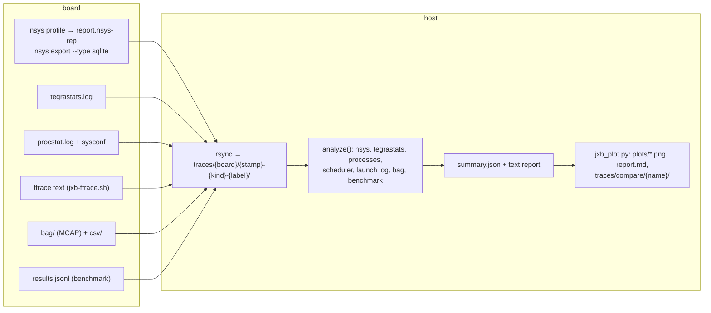

*Figure 8: From raw recordings to reports.*

### 7.2 Nsight Systems

`jxb trace nsys BOARD -- CMD` runs `nsys profile --trace cuda,nvtx,osrt,cublas,cudnn` with process-tree CPU
sampling and context-switch tracing, which works without root on a stock board (`perf_event_paranoid=2`; system-wide
sampling does not, F45). `--kill 2` ends the profiled process with SIGINT, so ROS nodes shut down cleanly. The report
is exported to SQLite **on the board** (`nsys export --type sqlite`), and `nsys_summary` evaluates it with SQL over
the CUPTI tables, for example the kernel statistics:

```sql
SELECT s.value, count(*), sum(k.end - k.start), max(k.end - k.start)
FROM CUPTI_ACTIVITY_KIND_KERNEL k JOIN StringIds s ON s.id = k.shortName
GROUP BY k.shortName ORDER BY 3 DESC
```

The sum of kernel durations overstates GPU utilization when kernels from several streams overlap. The **GPU busy
time** is therefore computed as the measure of the union of kernel intervals,

$$
B = \Big|\bigcup_{i} [s_i, e_i)\Big|, \qquad u_{\text{GPU}} = \frac{B}{t_1 - t_0},
$$

with a single pass over the intervals sorted by start time (`_union_ns`): an interval that starts after the current
merged interval ends closes it; otherwise it extends it. $[t_0, t_1]$ is the span covered by kernels, CUDA API
calls, OS runtime calls and NVTX ranges. The summary further contains memory copies by direction (`HtoD`, `DtoH`,
...), CUDA API calls, NVTX ranges, OS runtime calls and the hottest leaf functions of the CPU samples. Sections whose
tables differ between nsys versions fail individually and are reported in `errors`, while the others remain.

### 7.3 tegrastats

`tegrastats` is JetPack's telemetry tool (no root needed). A line such as (abridged, from the stack recording)

```text
01-15-1970 00:39:37 RAM 1168/7486MB (lfb 17x4MB) CPU [40%@1344,2%@1344,38%@1344,20%@1344,0%@1344,1%@1344]
GR3D_FREQ 0% cpu@49C/49C ... gpu@48.187C/48.25C tj@49C/49C ... VDD_IN 5811mW/5816mW/5821mW VDD_CPU_GPU_CV 1669mW/...
```

(note the board's clock at 1970) is parsed by regular expressions into a flat record (RAM, swap, per-core load and frequency, GPU load and frequency,
memory controller load, temperatures per zone, power per rail), written as CSV, and summarized as mean, minimum and
maximum per metric. With interval $\Delta t$ and input power samples $P_k$ (rail `VDD_IN`), the energy of the
recording is

$$
E = \sum_k P_k \,\Delta t .
$$

tegrastats runs on the board host, also in container mode, with no inherited standard streams
(`< /dev/null > /dev/null 2>&1`) so that a leftover can never hold the SSH channel open, and is stopped by an exit
trap (F62).

### 7.4 Per-process monitoring

`jxb launch --monitor` samples every process of the board once per second:

```bash
echo "R $$"; while :; do echo "T $(cut -d" " -f1 /proc/uptime)"
  if [ -n "$JXB_CN" ] && [ -z "$JXB_CP" ]; then
    JXB_CP=$(docker inspect -f "{{.State.Pid}}" "$JXB_CN" 2>/dev/null | grep -v "^0$") && echo "C $JXB_CP"; fi
  cat /proc/[0-9]*/stat 2>/dev/null; sleep 1; done
```

Each `T` line starts a sample; the `/proc/<pid>/stat` lines give the parent PID, user and system CPU ticks
(`utime + stime`), the start time and the resident set size. Attribution is by **ancestry**: `R` is the PID of the
session's shell and `C` the PID of the init process of its runtime container; a process belongs to the session if
one of its ancestors is a root. This is robust against other users' processes started during the recording (F53).
For a process with ticks $k_1, k_2$ at sample times $t_1, t_2$, and `CLK_TCK` $= h$:

$$
\text{cpu}(t_2) = 100\,\frac{k_2 - k_1}{h\,(t_2 - t_1)}\ \%, \qquad
\text{share} = 100\,\frac{k_{\text{last}} - k_{\text{first}}}{h\,T_{\text{recording}}}\ \%,
$$

where 100 % is one core. The *share* divides by the whole recording, so short-lived processes do not inflate the
total, while the *mean* divides by the process's lifetime. The sampler's own cost is reported separately
(`monitor_cpu_pct`, about 1.1 % of one core).

### 7.5 Kernel tracing

`jxb trace kernel` uses plain ftrace through tracefs, which every stock kernel has. The board helper
[`jxb-ftrace.sh`](../tools/board/jxb-ftrace.sh) saves the tracing state (`tracing_on`, buffer size, tracer, enabled
events, `record-tgid`), enables the requested events (scheduler, IRQ, power, syscalls, workqueue), records or
streams, and **restores the previous state on any exit**, since the board is shared. Root is required (tracefs is
`drwx------`): by default `sudo` asks the user for the password in the terminal (jxb never handles passwords);
alternatives are a privileged container (`--root docker`) or none.

`SchedStats` turns the ftrace text into scheduler statistics in one pass: per-task run time (time between being
switched in and out on a CPU), per-CPU busy time, context switches and preemptions (`prev_state=R`), IRQ and
softirq handler times, and the **wakeup latency** of each task,

$$
L = t_{\text{switch-in}} - t_{\text{wakeup}},
$$

reported as p50, p99 and maximum per task. On the PREEMPT_RT kernel of the board this is the quantity that
determines the reaction time of control nodes. The same class drives a live view that prints per-second statistics.

### 7.6 Inference benchmarks

`jxb trace bench BOARD --models M.onnx ...` runs a matrix of backends on the board
([`jxb_bench.sh`](../tools/board/jxb_bench.sh)): ONNX Runtime with the CPU, CUDA and TensorRT EPs (fp32, fp16, and
INT8 for models with Q/DQ nodes, detected by a `QuantizeLinear` node) through jxb's `ort_bench`, and native
TensorRT engines through `trtexec` (fp32, fp16, INT8). Each run yields p50, p90 and p99 latency, the GPU compute time
(trtexec) and the throughput as one JSON line. The summary sorts backends by p50 and reports the speedup
$S = \tilde{t}_{\text{ort-cuda}} / \tilde{t}_{\text{backend}}$ against ONNX Runtime's CUDA EP, the "no TensorRT"
baseline. Engines are built on the board (they are specific to the GPU and the TensorRT version) and kept for
reuse, for example as the SAM node's `model:=<...>.engine`.

### 7.7 Reports, plots and comparisons

`jxb trace report` prints the summary of a recording, `jxb trace plot` renders plots and a Markdown report with
matplotlib in the dev container, and `jxb trace compare A B ... --name N` puts several recordings side by side (for
example native versus container, or ONNX Runtime versus TensorRT) in `traces/compare/N/`. Figures 9 to 12 in
Section 9 were produced this way.

---

## 8. VS Code integration

Like the Renesas RDK, jxb integrates with VS Code through tasks and debug configurations, but every task only calls
`jxb`, so terminal and editor run the same code (R6). `jxb vscode init -w WS` writes a multi-root workspace file
`vscode/<ws>.code-workspace` (the ROS workspace plus the jxb repository); the workspace's own `.vscode/` stays
untouched. What the tasks act on is set in the workspace settings, which take the role of the RDK's
`settings.json` variables: `jxb.profile`, `jxb.mode`, `jxb.board`, `jxb.package`, `jxb.executable`,
`jxb.launchPackage`, `jxb.launchFile`, `jxb.launchArgs`, `jxb.launchWith`, `jxb.bagTopics`, `jxb.benchModels`,
`jxb.gdbPort`, `jxb.traceSeconds`. Tasks reference them as `${config:jxb.board}`; re-running `init` regenerates
tasks and configurations and keeps the settings.

| Group | Tasks |
|---|---|
| build | `jxb: build` (default build task, `$gcc` problem matcher), `jxb: build package (debug info)`, `... + deploy` |
| run | `jxb: deploy`, `jxb: run node on board`, `jxb: launch on board`, `jxb: launch + monitor (recorded)`, `jxb: launch + monitor + bag (recorded)`, `jxb: ssh to board` |
| debug | `jxb: gdbserver node`, `jxb: gdbserver node in launch`, `jxb: stop gdbserver launch` |
| trace | `jxb: trace nsys node`, `jxb: trace nsys launch`, `jxb: tegrastats live`, `jxb: kernel trace`, `jxb: kernel trace live (top)`, `jxb: trace report (latest)`, `jxb: trace plot (latest)`, `jxb: benchmark models` |
| checks | `jxb: board check`, `jxb: test suite on board`, `jxb: container shell` |

The two debug configurations use `cppdbg` with `miDebuggerPath` set to
[`toolchain/bin/jxb-gdb`](../toolchain/bin/jxb-gdb) (which runs `jxb gdb` with the profile's sysroot) and
`miDebuggerServerAddress` `127.0.0.1:${config:jxb.gdbPort}`. Their `preLaunchTask` starts `jxb debug --server-only`
as a **background task**; VS Code needs to know when the server is ready, which a problem matcher with a
never-matching pattern and `beginsPattern`/`endsPattern` set to `Listening on port` signals. For a node in a launch
file, a `postDebugTask` terminates the launch task through an input of type `command`
(`workbench.action.tasks.terminate`). The flow was verified by replaying the generated configuration over gdb's
machine interface the way `cppdbg` drives it (F47).

---

## 9. Evaluation

### 9.1 Setup

| | |
|---|---|
| Host | x86_64, 20 cores, 15 GB RAM, Docker; Arch-based Linux |
| Board | Jetson Orin Nano 8 GB, JetPack 7.2.1 (L4T 39.2.1), 25 W mode, GPU at 918 MHz, PREEMPT_RT kernel, NVMe |
| Workload | SAM ROS 2 workspace (snapshot 7552ca7f, 24-26 buildable packages); SAM detector models S0 (YOLO, fp32, 1x3x608x960) and quantized variants |
| Input | synthetic camera `jxb_image_pub.py`, 30 fps, 1280x800 (stack) |

The board is shared with other users; all measurements ran under the measurement lock. Each configuration was
recorded once for 40-120 s unless stated otherwise; the numbers are therefore indicative rather than statistically
established (Section 9.6).

### 9.2 Build side

| Profile | Sysroot packages | Sysroot size | Tests passed (host / board) | SAM workspace |
|---|---|---|---|---|
| `jp721-jazzy` | 944 | 16 GB | 12 / 8 | all but 2 packages, which need Kilted APIs (F15) |
| `jp721-kilted` | 995 | 16 GB | 14 / 9 | all but `pylon_camera_package` (Basler SDK) and the vendored `micro_ros_agent` (F54) |
| `jp721-lyrical-isaac` | 1068 | 19 GB | 15 / 10 (incl. Isaac ROS 5) | all but `localization_package` (Lyrical tf2, F28) and Pylon; `oak_camera_package` with jxb's depthai (F40) |
| `jp721-lyrical` | 1100 | 17 GB | 12 / detector in the runtime container | all but `localization_package` and Pylon (F28) |

The full SAM workspace cross-builds with Kilted in 2:18 min cold and 1:14 min with a warm ccache (F19), with zero
linkage problems reported by `jxb-elfcheck`. A sysroot rebuild from the cache takes about one minute. A full
parallel build initially ran out of memory on the 15 GB host (colcon runs `make -j<cores>` per package, so six
parallel packages meant up to 120 compiler processes; F54); `MAKEFLAGS=-j4` with three parallel packages builds all
26 packages in 3.5 min.

### 9.3 Inference baselines

| Model | Backend | p50 [ms] | p99 [ms] | Throughput [1/s] | Speedup vs. ORT CUDA |
|---|---|---:|---:|---:|---:|
| S0 fp32 | ONNX Runtime CPU | 355.0 | 515.1 | 2.5 | 0.10 |
| | ONNX Runtime CUDA EP | 35.1 | 36.1 | 28.5 | 1.00 |
| | ONNX Runtime TensorRT EP fp32 | 22.6 | 27.3 | 43.8 | 1.56 |
| | `trtexec` fp32 | 21.9 | 25.5 | 45.2 | 1.60 |
| | ONNX Runtime TensorRT EP fp16 | 11.9 | 14.1 | 82.1 | 2.95 |
| | `trtexec` fp16 | **10.8** | 12.0 | 90.9 | 3.24 |
| P1 PTQ INT8 | `trtexec` INT8 | 9.10 | 9.49 | 109.1 | 5.20 |
| S2 QAT INT8 | `trtexec` INT8 | 9.02 | 9.78 | 110.2 | 5.25 |
| Q4 full INT8 | `trtexec` INT8 | 8.92 | 9.19 | 111.4 | 5.36 |
| S3 QAT INT8 (n-model) | `trtexec` INT8 | **6.75** | 7.18 | 146.6 | 3.98 |

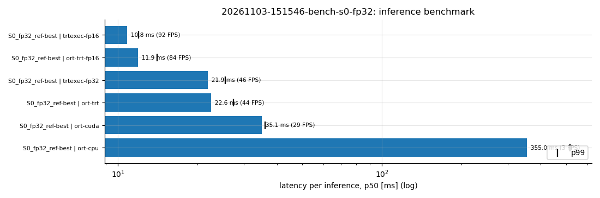

*Figure 9: p50 latency of the S0 model per backend, with p99 marks (`jxb trace plot` of the benchmark recording).*

Three observations follow. (1) TensorRT is the decisive factor: fp16 engines are 3.2x faster than ONNX Runtime's
CUDA EP. (2) ONNX Runtime's TensorRT EP is within about 10 % of `trtexec` (11.9 vs. 10.8 ms), so an application
can keep the ONNX Runtime API and still get most of the benefit. (3) INT8 gains only about 17 % over fp16 for the
s-sized model on the Orin Nano; the smaller n-model is the larger lever. Without TensorRT, the Q/DQ models are
*slower* than fp32 (CUDA EP 47 ms vs. 35 ms), because the quantization nodes are executed as fake quantization.
An nsys trace of the CUDA EP run explains part of its cost: the inputs come from pageable host memory and are staged
synchronously (`cudaMemcpyAsync` took 962 ms of API time for 430 MB, which the GPU copied in 55 ms), and layout
conversion kernels take 6.4 % of the GPU time (F46).

### 9.4 The SAM detector node

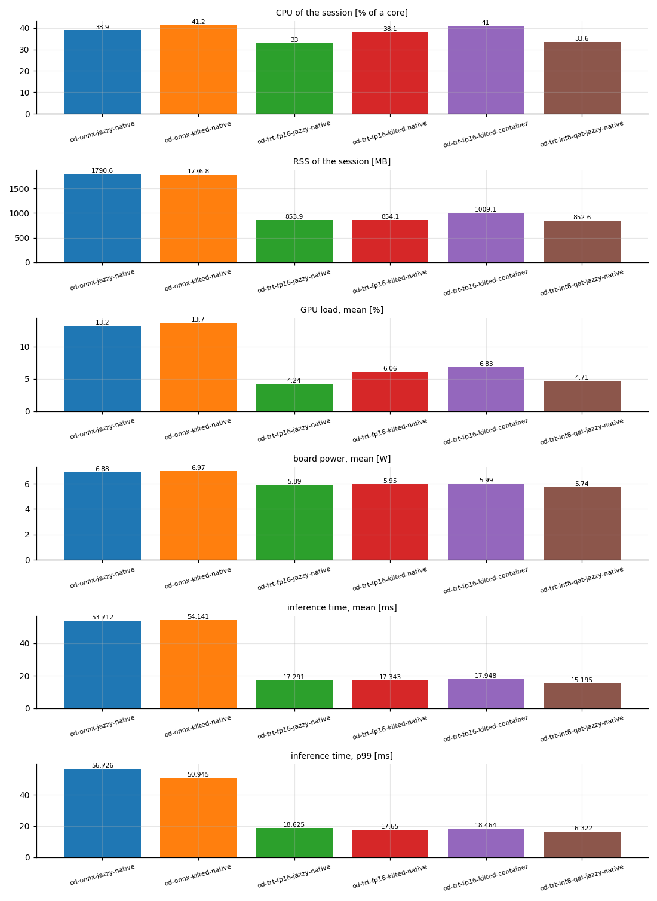

*Figure 10: SAM's `object_detection` node with the synthetic camera, per backend, distribution and run-time mode
(`jxb trace compare`).*

In the node, inference takes 46.4 ms p50 with ONNX Runtime's CUDA EP, 17.2 ms with a TensorRT fp16 engine and
15.1 ms with an INT8 (QAT) engine; the TensorRT backends also halve the session's memory (1.79 GB vs. 0.85 GB) and
save about 1 W (6.9 vs. 5.9 W). The node adds 6-11 ms around the engine, and it runs a fixed 5 Hz loop, so the GPU is
busy only 4-13 % of the time; the detection rate is bounded by that loop, not by the GPU (F50). Jazzy and Kilted
give the same results within noise; under Lyrical (Isaac Buildfarm, native) memory and CPU are the same as well
(1.83 GB with ONNX Runtime, 0.89 GB with TensorRT); its inference times were not recorded in that campaign, because
bag recording failed with the Lyrical runtimes (fixed since, F68: a later run gives a median of 17.3 ms). The runtime container differs from the first
native run by +0.6 ms and +0.14 GB, but a second native run differs from it by as much (+0.5 ms, +0.14 GB): the
container's cost is within run-to-run variation ([measurements.pdf](latex/measurements.pdf), Section 3.3).

### 9.5 The full SAM stack

The complete stack (`launch/launch.py module:=parking`: core, object detection, parking and traffic lights; Kilted;
TensorRT fp16 detector) was run for 120 s with the synthetic camera at 30 fps, natively and in the runtime container.

| Configuration | Processes | CPU [cores] | Session RSS [GB, 1024 MB] | GPU mean / max [%] | Board power [W] | Max. temp. [°C] |
|---|---:|---:|---:|---:|---:|---:|
| native, TensorRT fp16 | 12 | 2.83 | 2.11 | 12.6 / 84 | 8.36 | 53.0 |
| container, TensorRT fp16 | 12 | 2.75 | 2.07 | 12.5 / 88 | 8.32 | 53.2 |
| native, ONNX Runtime CUDA EP | 12 | 2.93 | 2.92 | 26.8 / 99 | 9.39 | 54.5 |
| native, one process per node | 18 | 2.36 | 1.92 | 13.5 / 88 | 8.11 | 53.6 |

All processes started and stopped cleanly in every configuration. The composable-node container that hosts the
image pipeline is the dominant consumer (1.6 cores, 534 MB); the detector takes 0.33 cores and 772 MB, the synthetic
camera 0.36 cores. Lane points are produced at 23 Hz and undistorted images at 20-23 Hz from 30 fps input, so the
image pipeline does not keep up with the camera; detections arrive at the node's 5 Hz. In the loaded system the
detector's inference p50 rises from 17 ms (alone) to 25 ms. An Nsight Systems trace of the stack shows the GPU busy
6.2 % of the time, with 2.86 GB host-to-device and 3.10 GB device-to-host copies in 46 s, i.e. the pipeline moves
images between CPU and GPU memory for every stage.

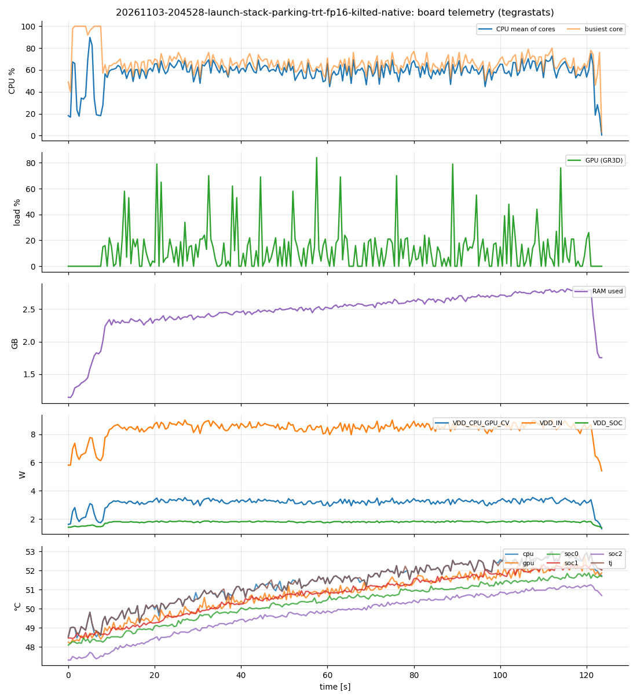

*Figure 11: tegrastats of the stack run (native, TensorRT fp16): CPU, GPU, RAM, power rails and temperatures.*

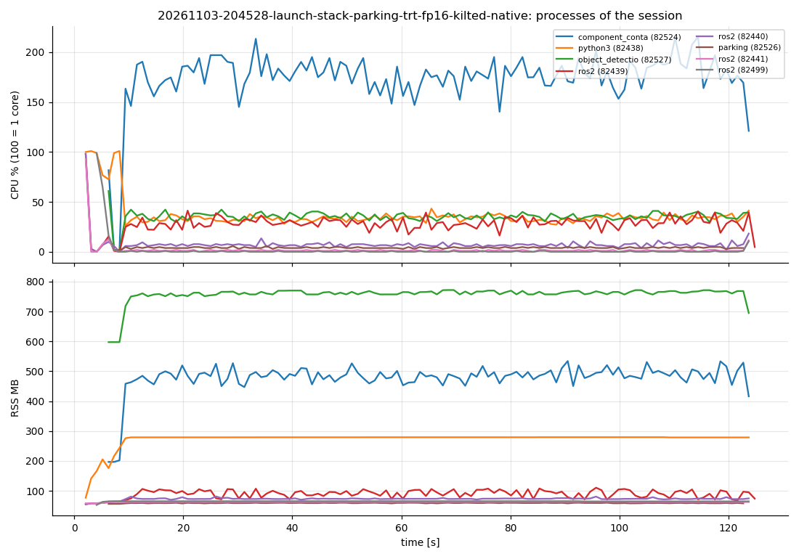

*Figure 12: CPU (100 = one core) and resident memory of the stack's processes over time.*

### 9.6 Discussion and threats to validity

The results support three conclusions about the system itself. First, the cross-built binaries are functionally
identical to native builds: all tests pass on the board, and the SAM stack runs unchanged under three ROS
distributions. Second, container mode is a viable alternative to native execution: the differences (+0.6 ms
inference, +0.14 GB, ±3 % CPU) are no larger than those between two native runs. Third, the observability pipeline is cheap enough
to use routinely (about 1 % of a core).

The measurements have limitations. Each configuration was recorded once, on one board, which other users shared
(the lock serializes measurements but not, for example, thermal history). The synthetic camera replaces real
sensors, so the planning and control chain stays idle without odometry. The board's clock and thermal state were
not controlled beyond recording them. The numbers are baselines for comparisons on this platform, not general
performance claims.

---

## 10. Challenges and lessons learned

Of the 62 findings in [findings.md](findings.md), those that describe problems fall into seven groups. For each
group we state the symptom, the root cause, the resolution and the general lesson.

### 10.1 CUDA cross-compilation

- **Layout change.** CUDA 13 on Orin uses `targets/sbsa-linux` (F2). *Lesson:* check the target layout of every new
  JetPack major release; jxb adds the old name as an alias for older CMake.
- **The probing problem.** `FindCUDAToolkit` probes `nvcc` without flags and picked up x86 include directories for
  C++-only targets (F5). *Resolution:* make the image's toolkit target-only (`nvcc.profile`, `NVCC_CCBIN`).
  *Lesson:* configure tools so that their **defaults** are correct; flags are not always passed.
- **Missing sysroot flag.** CMake passes no `--sysroot` when the host compiler links CUDA targets (F6).
- **A compiler bug.** CUDA 13.2's CCCL headers declare specializations in a way GCC 13/14 reject when nvcc re-emits
  them (F22); the fix suggested upstream is insufficient for `.cu` files, a namespace-scoped declaration works.
- **Legacy modules.** `FindCUDA` takes the target directory from an environment variable only (F31).

### 10.2 Sysroot semantics

- **Scripts matter, a little.** Alternatives (F43), literal `ln -s` (F13) and a boot-time service (F26) create files
  that builds need. *Lesson:* enumerate side effects instead of executing scripts; skip what cannot be determined
  statically rather than guessing.
- **Key formats** (F16) and **pins** (F17) must be reproduced exactly.
- **Symlinks** must be relative (Section 4.6), and CMake must resolve them before computing prefixes (F39).
- **Toolchain files are read more than once** (F33): use idempotent `list(APPEND)`, never `set()`.

### 10.3 Binary portability

- **Absolute `DT_NEEDED`** from libraries without `SONAME` (F44), invisible to a check that runs where the path
  exists. *Lesson:* verify binaries under the target's view of the file system, not the host's.
- **Build-time paths in generated files**: colcon setup scripts and ament's `parent_prefix_path` record the sysroot
  path (F37). *Resolution:* rewrite after every build.
- **Python extension suffixes** (F12) and **CPU models** for emulated tests (F25).

### 10.4 Board runtime

- **Essential packages** are never dependencies, so a sysroot has no shell until they are requested explicitly
  (F48).
- **Group names versus numbers** in containers whose image is a sysroot (F48).
- **Undeclared run-time dependencies** in launch files (F52, F60) and **system Python modules** of another
  distribution (F61). *Lesson:* a runtime made from declared dependencies is a strict test of those declarations.
- **Incomplete packages** break sourcing a whole workspace (F57); **Git LFS pointers** silently replace data
  (F51).

### 10.5 Process lifecycle on remote boards

Remote processes outlive their controllers in many ways: an early-dying launch leaves nodes, `pkill -f` hits the
wrong processes, background tools inherit SSH file descriptors (F58, F62). *Lesson:* manage **process groups**, not
processes; never match command lines; give background tools no inherited standard streams; and make cleanup part of
every exit path (traps).

### 10.6 Shared hardware

- **Overlapping measurements** (F53) led to the measurement lock and ancestry-based attribution.
- **An unexplained reset**: the Nano reset about 3 s into the first run of ONNX Runtime's CUDA EP inside the runtime
  container, while the EP was initializing (F56). Nothing unusual preceded it (1.5 GB RAM, 49 °C, 6.7 W); TensorRT in
  the same container ran fine before and after; the CUDA EP runs fine natively. The container differs from native
  in its cuDNN version (9.20 from the sysroot vs. the board's 9.25). The cause cannot be determined without root
  (the panic log would be in `/sys/fs/pstore`), so this combination is excluded from container runs until then.
  *Lesson:* on shared hardware, an unexplained fault is a policy decision, not only a bug.

### 10.7 Upstream issues found

| Component | Issue | Finding |
|---|---|---|
| ROS 2 rosidl | `file(STRINGS)` without `ENCODING UTF-8` breaks non-ASCII workspace paths | F11 |
| CUDA 13.2 CCCL | specialization outside its namespace, rejected by GCC 13/14 | F22 |
| ONNX Runtime | released aarch64 CUDA EP has no `sm_87` code; release CMake config paths | F8, F9 |
| SAM | `CMAKE_CUDA_ARCHITECTURES` set unconditionally without 87; `ekf_core` not installed under Lyrical; hard-coded plugin path | F18, F55 |
| Lyrical tf2 | `tf2/LinearMath/Quaternion.h` removed (only `.hpp`) | F28 |
| ORT C++ API | `GetInputTypeInfo(i).GetTensorTypeAndShapeInfo()` is a view into a temporary | F41 |

---

## 11. Implementation process

### 11.1 Timeline

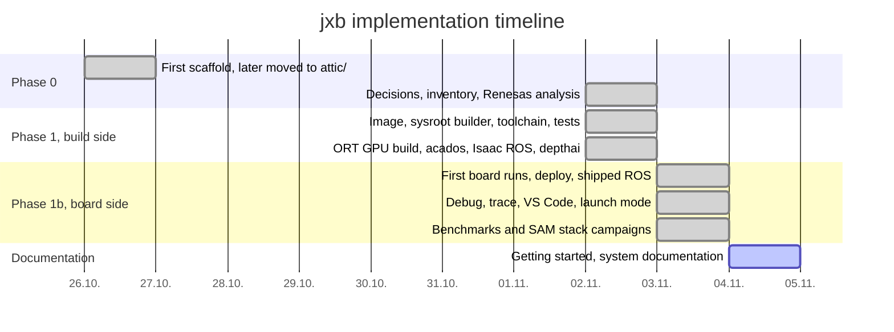

*Figure 13: Implementation timeline.*

**Phase 0** (decisions). A first scaffold from 2026-10-26 had never been built or tested; it was kept in `attic/`
for reference. The decisions recorded in [PLAN.md](../PLAN.md) fixed the boundary conditions: boards stay on stock
JetPack (D1); Lyrical runs both in a container and natively from NVIDIA's Buildfarm (D2); C++ for the later agent
and GUI (D5).

**Phase 1** (build side, 2026-11-02). The order of work followed the dependency chain: image, sysroot builder,
toolchain, test suite, then the real workload. Each layer was accepted only when its probe test passed (CUDA, then
TensorRT, ONNX Runtime, ROS interfaces, a CUDA ROS node). The SAM workspace exposed the remaining problems (Kilted
APIs, acados code generation, the UTF-8 path bug); ONNX Runtime had to be built from source for `sm_87`.

**Phase 1b** (board side, 2026-11-03). With SSH access to the Nano, the cross-built tests ran 8/8 after one fix to
the board runner (sourcing ROS setup scripts without `set -u`, F36, F37). The board-side features followed from concrete needs: shipping a ROS distribution (to run Kilted
on a Jazzy board), the library closure check (after an Isaac test binary failed), debugging, tracing, the launch
mode, container mode, and finally the measurement campaigns of Section 9, which in turn found the undeclared
dependencies and lifecycle problems of Section 10.

### 11.2 Method

- **Evidence-driven engineering.** Every non-obvious observation was written down as a numbered finding with its
  consequence for the system before the next step; the findings log is both the design rationale and the
  regression list.
- **Probe-first verification.** Each capability has a minimal probe (Section 5.8) that exercises exactly one layer,
  so a failure points to its cause; only then is the full SAM workspace built.
- **Static checks of generated shell.** jxb composes nested shell scripts (lock wrapper, container wrapper,
  environment, launch script). During development they were checked with `bash -n` through a dry-run harness that
  replaced the command runner and recursively checked every nested `bash -c` script.
- **Real hardware as the final test.** QEMU runs catch instruction-set and linkage errors early, but every feature
  was accepted only after it ran on the Nano.
- **Agent-assisted, parallel development.** The work was carried out with AI coding agents (Claude Code) under the
  direction of the project owner: a main development session, forked sessions for reviews and long measurement
  campaigns, and a separate hardware-in-the-loop session that shared the board. Coordination used explicit
  ownership of files and measurements and, on the board, the measurement lock, which the HIL session adopted. A
  forked review found the process-group issues of Section 6.6 (F58).

### 11.3 Incidents

- **Out-of-memory builds** (exit 137) on the 15 GB host, resolved by bounding parallelism (F54).
- **The board reset** described in Section 10.6, which also interrupted other sessions on the shared board.
- **Lost work** when a session restored an earlier checkpoint and overwrote files; the changes were re-applied
  from the session transcript. *Lesson:* commit early on shared working trees.

---

## 12. Limitations and future work

Open issues of the current state:

- **Kernel tracing on the board** has only been tested against a mock tracefs; a real run needs root, i.e. a sudo
  password typed by the user or explicit approval of the privileged-container route on the shared board.
- **The reset of F56** is not explained (pstore needs root).
- **Lyrical runtimes** (fixed 2026-11-04): `ros2 bag record` needs `--topics` there (F68), and SIGINT has to be
  restored before `ros2 launch` because Ubuntu 26.04's `timeout` passes it on ignored (F69).
- **Single board class.** Only an Orin Nano was available; AGX Orin and Thor (GPU variant `openrm`) are prepared in
  the profile format but untested.
- **Missing pieces of the SAM stack**: the Basler Pylon SDK, ros2_control and Gazebo (a size decision for the
  sysroots), CUDA kernel debugging with `cuda-gdb`.

Planned next steps ([PLAN.md](../PLAN.md)): an `orin-agent` daemon with a stable API (health, deploy, run, logs,
trace) as the common backend of `jxb` and the later JetsonPlanner GUI; multi-board deploys and synchronized traces
on several boards with Perfetto as the common trace format; a provisioning bundle (apt repository with cross-built
`.deb` files, container images, configuration) on top of stock JetPack, versioned together with the sysroot's
package lock; and CI for images, sysroots and the probe tests.

---

## 13. Conclusion

jxb shows that a correct cross-development environment for Jetson Orin can be **constructed** rather than copied:
a private apt instance resolves the board's package closure from the board's own repositories, extraction plus a
small, explicit emulation of maintainer-script effects yields a sysroot that matches the board by construction, and
a toolchain whose defaults are pinned to the board compiles C++, CUDA and Python extensions without emulation. The
same sysroot doubles as the root file system of a GPU-enabled runtime container, which lets one stock board run
three ROS distributions natively or in a container. On top, a launch mode with process-group lifecycle management
and an observability pipeline with machine-readable summaries turn the board into a measurable system. Most of the
effort went into details that are invisible when building natively, such as symlink semantics, `DT_NEEDED` records,
generated paths, undeclared dependencies and process lifecycles; documenting them, as this report and the findings
log do, is what makes the system maintainable.

---

## Appendix A: command reference

| Command | Purpose |
|---|---|
| `jxb image build \| runtime` | build the xbuild image / the board runtime image of the profile |
| `jxb sysroot build [--add PKG ...] [--no-update]` | build the sysroot from the board's repositories |
| `jxb sysroot rosdeps -w WS` | workspace rosdeps + launch-file dependencies → `sysroot/sets/ws-<profile>-<ws>.txt` |
| `jxb sysroot info` | metadata of the current sysroot |
| `jxb up [-w WS ...] [--recreate]`, `jxb down` | create / remove the dev container |
| `jxb shell`, `jxb exec -- CMD` | shell or command in the dev container |
| `jxb build [colcon args]` | `cross-colcon-build` in the current workspace |
| `jxb test [--board B]` | build and check the test suite, optionally run it on a board |
| `jxb board list \| check B` | inventory; compare a board's package versions with `packages.lock` |
| `jxb deploy B [--ws WS] [--packages P ...] [--no-files]` | deploy a workspace |
| `jxb run B -- CMD`, `jxb ssh B` | command / shell on the board with the deployment's environment |
| `jxb gui B -- PROGRAM` | a board program as a window here (X11 over SSH) |
| `jxb launch B [--packages ...] [--monitor] [--bag [T ...]] [--with CMD] [--duration S] -- TARGET` | deploy and launch, optionally recorded |
| `jxb debug B --pkg P --exe E [--launch PKG FILE] [--server-only] [--cuda]` | remote debugging (`--cuda`: cuda-gdbserver + cuda-gdb) |
| `jxb gdb [--cuda] [-- ARGS]` | cross gdb (or cuda-gdb) for the profile |
| `jxb trace nsys \| tegrastats \| kernel \| bench B ...` | recordings on the board |
| `jxb trace report \| plot \| compare \| perfetto \| list \| gui` | analysis on the host; `perfetto`: one timeline of recordings |
| `jxb vscode init -w WS [--board B ...] [--pkg P --exe E]` | VS Code workspace (several `--board`: debugging on all of them at once) |

Global options: `--profile NAME`, `--mode auto|native|container`, `--dry-run` (prints commands instead of running
them). The board argument of `deploy`, `run`, `launch`, `test --board`, `board check` and the recordings also takes
`B,B`, `@GROUP` or `all`: the command runs on those boards at once, with a result table. Details:
[workflows.md](workflows.md).

## Appendix B: configuration reference

**Profile** (`profiles/<name>.toml`):

| Key | Meaning |
|---|---|
| `inherit` | parent profile; tables merge recursively |
| `[board]` `jetpack`, `l4t`, `soc`, `cpu_flags`, `cuda_arch`, `gpu_variant`, `ros_distro`, `ros_mode`, `qemu_cpu` | the board's software and hardware |
| `[image]` `tag`, `ubuntu`, `ros_distro`, `ros_apt_url`, `cuda_version`, `cuda_pkg_version` | xbuild image build arguments |
| `[sysroot]` `dir`, `codename`, `python`, `cuda_target`, `sources`, `preferences`, `package_sets`, `extras`, `rosdep_fallback_codename` | sysroot recipe |
| `[keys]` | apt keyrings (paths or URLs) |
| `[extras.<name>]` | `tarball`/`debs`/`url`, `dest`, `optional`, `build` |
| `[container]` `board_paths` | board paths mapped into the dev container |
| `[deploy]` `runtime`, `container` | shipped runtime extras; force container mode |

**`boards.toml`** (local): `[defaults]` and `[boards.<name>]` with `host`, `user`, `ssh_port`, `deploy_dir`,
`codename`, `gdb_port`, `nsys`, `trace_dir`, `measure_lock`, `trt_cache`, `cuda_gdbserver`, `groups` (for `@GROUP`),
`ros_domain_id`.

**`jxb.toml`** (local): `profile`, `mode`, `workspaces`, `[sysroot] extra_sets`, and per workspace
`[workspace.<dir>]` `files` (deployed source-tree files), `env` (board environment) and `container_env`
(additional variables in container mode, e.g. `RMW_IMPLEMENTATION`).

## Appendix C: the `summary.json` schema

| Key | Present for | Content |
|---|---|---|
| `trace`, `dir`, `meta` | all | name, directory, `meta.json` |
| `board_state` | all (since 2026-11-04) | `start`, `end`: `nvpmodel`, `cpu.<policy>` (`governor`, `min_mhz`, `max_mhz`, `cur_mhz`, `hw_min_mhz`, `hw_max_mhz`), `devfreq.<device>` (`governor`, `min_mhz`, `max_mhz`, `cur_mhz`; GPU, EMC = `bwmgr`, engines), `cpuidle` (`states`, `disabled`), `gpu_railgate`, `fan`, `temp_c`; `fixed` (clocks with minimum = maximum, disabled idle states), `changed` (settings that differ between start and end) |
| `nsys` | nsys | `span_s`, `gpu` (`kernel_launches`, `kernel_time_ms`, `busy_ms`, `busy_pct`, `top_kernels`), `memcpy`, `cuda_api`, `nvtx`, `os_runtime`, `cpu_samples`, `processes` |
| `tegrastats` | `--tegrastats`, `--monitor`, bench | `samples`, `interval_ms`, `duration_s`, `metrics.<key>.{mean,min,max}`, `energy_j`, `csv` |
| `processes` | `--monitor` | `session_cpu_pct`, `session_rss_mb`, `monitor_cpu_pct`, `session[]`/`top[]` with `cpu_share_pct`, `cpu_mean_pct`, `cpu_max_pct`, `rss_max_mb`, `series` |
| `launch` | launch | `processes`, `finished_cleanly`, `died`, `crashed`, `errors`, `warnings`, `first_errors` |
| `bag` | `--bag` | topics with type, message count and rate; CSV series of numeric topics |
| `kernel` | kernel | `span_s`, `events`, `ctxsw_per_s`, `cpu_busy_pct`, `top_tasks` (with `wakeup_us` p50/p99/max), `top_processes`, `irqs` |
| `bench` | bench | per model: runs sorted by p50 with `p50_ms`, `p99_ms`, `fps`, `speedup_vs_ort_cuda` |

## Appendix D: FAQ and known issues

**Why not just build on the board?** It works for small packages, but the Orin Nano has 8 GB shared between CPU
and GPU and six cores; the SAM workspace takes minutes on the host and much longer on the board, and building there
requires `-dev` packages on a board that should stay stock.

**Why not QEMU?** Emulated compilation is roughly an order of magnitude slower, and `nvcc` under emulation was
unreliable (P2). jxb uses QEMU only for optional smoke tests.

**Can I use my own CMake project without colcon?** Yes: in the dev container, `source /opt/jxb/toolchain/env.sh`
and configure with `-DCMAKE_TOOLCHAIN_FILE=$JXB_TOOLCHAIN_FILE`.

**The board's package versions differ from the sysroot (`DIFF` in `jxb board check`).** Patch-level differences
within a release are ABI-compatible (F35). Major differences mean the board is not on the profile's JetPack.

**A node finds the wrong ONNX Runtime.** jxb's GPU build comes first on `LD_LIBRARY_PATH` only through jxb's
environment (`jxb run`, `jxb launch`, `jxb ssh`); a plain SSH shell sees the board's CPU-only `/opt/onnxruntime`.

**Known issues.** ONNX Runtime's CUDA EP in container mode (F56); `pylon_camera_package` needs the Basler SDK; `micro_ros_agent` fails on Kilted (vendored Fast DDS
references `tinyxml2::tinyxml2`, F54). More in [getting-started.md](getting-started.md), Section 6.

## Appendix E: glossary

| Term | Meaning |
|---|---|
| ABI | application binary interface: calling convention, data layout and symbol versions that binaries rely on |
| CDI | Container Device Interface: a specification that describes device nodes and mounts for containers |
| closure | the set of packages reachable through dependencies from the requested ones |
| EP | ONNX Runtime execution provider (CPU, CUDA, TensorRT) |
| fp16 / INT8 / Q/DQ | half precision; 8-bit integer; explicit quantize/dequantize nodes in an ONNX model |
| L4T | Linux for Tegra, NVIDIA's board support package (Jetson Linux) |
| merged `/usr` | layout where `/bin`, `/lib`, `/sbin` are symlinks into `/usr` |
| PREEMPT_RT | the real-time preemption patch set of the Linux kernel |
| SBSA | Arm Server Base System Architecture; NVIDIA's unified Arm CUDA target layout |
| SONAME | the name a shared library declares for itself, recorded by the linker in `DT_NEEDED` |
| sysroot | a directory treated as the target's root file system by compiler and linker |
| underlay / overlay | an installed ROS environment / a workspace built on top of it |

## References

- **[R1]** Renesas Electronics, *RZ/V2H RDK documentation: Development guide*.
  <https://renesas-rdk.github.io/rzv2h_rdk_documentation/latest/chapter-4/development_guide/development_guide.html>
- **[R2]** Renesas Electronics, *RZ/V2H RDK documentation: Cross build setup*.
  <https://renesas-rdk.github.io/rzv2h_rdk_documentation/latest/chapter-4/development_guide/cross_build_setup.html>
- **[R3]** Renesas Electronics, *RZ/V2H RDK documentation: VS Code workspace*.
  <https://renesas-rdk.github.io/rzv2h_rdk_documentation/latest/chapter-4/development_guide/vs_code_ws.html>
- **[R4]** Renesas Electronics, *RZ/V2H RDK documentation: Cross build FAQ*.
  <https://renesas-rdk.github.io/rzv2h_rdk_documentation/latest/chapter-4/development_guide/cross_build_faq.html>
- **[R5]** Renesas RDK, *ubuntu_xbuild_toolchains* (open-source toolchain files of the RDK).
  <https://github.com/renesas-rdk/ubuntu_xbuild_toolchains>
- **[N1]** NVIDIA, *Jetson Linux and JetPack documentation*. <https://docs.nvidia.com/jetson/>
- **[N2]** NVIDIA, *CUDA Compiler Driver NVCC*. <https://docs.nvidia.com/cuda/cuda-compiler-driver-nvcc/>
- **[N3]** NVIDIA, *Nsight Systems User Guide*. <https://docs.nvidia.com/nsight-systems/UserGuide/>
- **[N4]** NVIDIA, *CCCL issue 8833*. <https://github.com/NVIDIA/cccl/issues/8833>
- **[C1]** Kitware, *cmake-toolchains(7)*. <https://cmake.org/cmake/help/latest/manual/cmake-toolchains.7.html>
- **[C2]** colcon documentation. <https://colcon.readthedocs.io/>
- **[C3]** Open Robotics, *ROS 2 documentation*. <https://docs.ros.org/>
- **[C4]** The Linux kernel documentation, *ftrace - Function Tracer*.
  <https://www.kernel.org/doc/html/latest/trace/ftrace.html>
- **[C5]** CNCF, *Container Device Interface*. <https://github.com/cncf-tags/container-device-interface>
- **[C6]** Debian, *Debian Policy Manual* (maintainer scripts, alternatives). <https://www.debian.org/doc/debian-policy/>
- **[C7]** *System V Application Binary Interface* (ELF). <https://refspecs.linuxfoundation.org/elf/gabi4+/contents.html>
